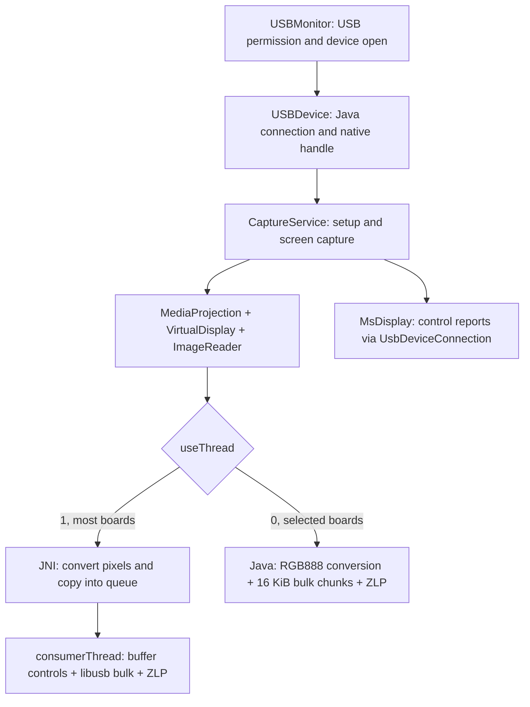

# MSDisplay Android 2.0.0.3: static protocol analysis

Static analysis performed on 2026-10-19 of the supplied
`drivers/MSDisplay_Android_v2.0.0.3.apk`, compared with the Linux driver in
this repository and the other supplied vendor drivers. The APK was extracted,
its DEX was decompiled to reconstructed Java, and its ARM libraries were
disassembled. No command was sent to the USB adapter.

## Main findings

Android is a useful protocol reference because Java class, method, constant,
and JNI symbol names survived in the package. Most configuration commands are
implemented in Java. `libusb101.so` provides USB transport; `libmsusb.so`
adds pixel conversion and a queued sender.

The active Android path selects **whole-frame mode (`FRAME = 0`)**, switches
two frame identifiers, sends raw pixels to bulk **OUT endpoint `0x04`**, then
ends each frame with a zero-length bulk transfer (ZLP). The Linux driver in
this repository selects **manual-block mode (`MANUAL_BLOCK = 3`)** and sends
UYVY damage rectangles with their own header and terminator. These are two
different protocol modes. Android's frame payloads cannot be substituted for
the Linux rectangle payloads without changing the configured mode and proving
the firmware accepts the result.

The APK resolves two names that were previously unknown in the Linux source:

| Existing Linux name | Name in the Android Java source | Meaning |
| --- | --- | --- |
| `MS912X_CMD_UNKNOWN1`, `0x03` | `TRANSMODE` | Selects the transfer mode |
| `MS912X_CMD_UNKNOWN2`, `0x04` | `STARTTRANS` | Starts or stops transmission |

This confirms the command names; it does not demonstrate performance or
acceptance by a particular physical adapter.

## Input files and reproducibility

The APK is 2,301,719 bytes, SHA-256:

```text
f27d80ec8242c67d0d3b89bbdd4d130d2fff98aa4a385e2a7138ce104bb7cbb9
```

Decoded manifest metadata: package `com.ms.ms2160`, version `2.0.0.3`,
versionCode 1, minSdk 21, targetSdk 26, compileSdk 28. It contains only
`armeabi` and `armeabi-v7a`, both 32-bit ARM. Each ABI has `libmsusb.so` and
`libusb101.so`; there is no ARM64 or x86 library in this APK.

Local artifacts, relative to the repository root:

| Path | Contents |
| --- | --- |
| `drivers/android-analysis/unpacked/` | Original APK/ZIP members, including `classes.dex` and four `.so` files |
| `drivers/android-analysis/jadx/sources/` | 752 reconstructed Java files; 30 under the app's `com.*` packages |
| `drivers/android-analysis/jadx/resources/` | Decoded manifest and resources |
| `drivers/android-analysis/native/<ABI>/` | Symbols, dependencies, offset strings, and assembly for each library |
| `drivers/android-analysis/jadx.log` | Decompiler log |
| `drivers/android-analysis/jadx-version.txt` | JADX version 1.5.6 |
| `drivers/android-analysis/SHA256SUMS` | APK and extracted-library hashes |

The APK contains DEX bytecode, not individual JVM `.class` files. The `.java`
files are reconstructions from DEX, and the `.so` files require separate
native-code analysis.

JADX returned status 3 with two errors in the Android UI library classes
`android.support.v7.util.DiffUtil` and
`android.support.v7.widget.GridLayoutManager`. Those errors are in Android
support-library code. No `JADX ERROR` marker was found in the app's own source
files or in `MsDisplay`, but reconstructed Java is not guaranteed to exactly
match the original source.

Reproduce extraction, Java decompilation, and native disassembly with:

```sh
bash tools/android/analyze-apk.sh
```

The script does not install tools, access the network, or open USB devices. It
uses Python 3, `readelf`, `strings`, `llvm-objdump`, and `jadx`. JADX
configuration/cache directories are kept inside the output tree, so the script
can run with ordinary user permissions. It preserves JADX's exit status and
error log. To only extract and disassemble the binaries:

```sh
bash tools/android/analyze-apk.sh \
  drivers/MSDisplay_Android_v2.0.0.3.apk \
  drivers/android-analysis --skip-java
```

`drivers/` is ignored by Git in this repository. Decompiled artifacts remain
local; the report and script are the files intended for the repository.

## Architecture and active data path



`USBMonitor` requests permission with `UsbManager.requestPermission` and opens
`UsbDeviceConnection`. `USBDevice.open` clones the connection block and passes
VID, PID, file descriptor, bus, address, and `/dev/bus/usb` path to JNI.
`libmsusb` uses extensions from its bundled libusb, including `libusb_init2`
and `libusb_get_device_with_fd`, followed by `libusb_open`. This lets the app
use the Android-authorized device; this path does not invoke `su`.

The app claims interface index 0. `CaptureService.onConnect` looks for
endpoint address 4. The USB device filter contains:

| VID:PID | Decimal values in the XML |
| --- | --- |
| `534d:6021` | `21325:24609` |
| `345f:9132` | `13407:37170` |

Other IDs accepted by the Linux driver do not appear in this filter. This
defines the APK's device list; it does not prove that other devices would
reject its commands.

After `MediaProjectionActivity` grants capture access, the service creates a
`VirtualDisplay` and `ImageReader.newInstance(width, height, 1, 2)`. Format 1
is the RGBA input used by its converters. The service accounts for row stride
and calls `acquireLatestImage()`, favoring the newest available image.

`showSystemParameter` chooses the JNI mode. Board names containing
`kirin970`, `k62v1_64_bsp`, `tb8321p2_bsp`, or `ch009_wt` use the Java path;
other boards use the native consumer. `DaemonService` and
`KeepAliveJobService` keep or restart the service; they do not implement a
second video protocol.

Sources: [CaptureService.java](../drivers/android-analysis/jadx/sources/com/ms/ms2160/service/CaptureService.java),
[USBDevice.java](../drivers/android-analysis/jadx/sources/com/ms/ms2160/myapplication/USBDevice.java),
[USBMonitor.java](../drivers/android-analysis/jadx/sources/com/ms/ms2160/myapplication/USBMonitor.java),
[MediaProjectionActivity.java](../drivers/android-analysis/jadx/sources/com/ms/ms2160/myapplication/MediaProjectionActivity.java),
and [device_filter.xml](../drivers/android-analysis/jadx/resources/res/xml/device_filter.xml).

## USB control transfers

Commands are 8-byte HID-style reports sent over the USB control endpoint. They
all use `wValue = 0x0300` and `wIndex = 0`:

| Operation | `bmRequestType` | `bRequest` | Length |
| --- | --- | --- | --- |
| Send command, `SET_REPORT` | `0x21` | `0x09` | 8 bytes |
| Read response, `GET_REPORT` | `0xA1` | `0x01` | 8 bytes |

`0x0300` selects Feature Report, report ID 0. Payload bytes `B5`, `B6`, and
`A6` are not the USB setup packet's `bRequest` values. Negative Java `byte`
values are shown here as unsigned hexadecimal values.

Read a 16-bit-addressed register:

```text
OUT: B5 addr_hi addr_lo 00 00 00 00 00
IN:  GET_REPORT, 8 bytes; returned value is at response byte index 3
```

Write one byte:

```text
OUT: B6 addr_hi addr_lo value 00 00 00 00
```

The payload address is big endian. Bit helpers perform host-side
read-modify-write. Normal Java register reads use a **1000 ms timeout**.
Despite its name, `xdata_read_atomic` makes two separate Java calls with a
**5 ms timeout**; it does not acquire a lock to make the pair atomic. The
native library separately has `usbControlTransferRead`, which holds a mutex
across the OUT/IN pair, but the Java helper used by this app does not call it.
That native helper is at `0x21E0` in the ARMv7 ELF; `usbControlTransfer` is at
`0x2338`.

The supplied MS9132 Linux source is untrusted and provides hints only. It
contains the same report format and a B5 helper that attempts to retrieve up
to four consecutive bytes in one response. That does not establish hardware
support for four-byte reads. The Android implementation described here reads
its register value from byte 3.

That Linux header also names payload opcode `0x12` as a two-byte write, but
only defines the opcode; its implementation does not demonstrate the write's
address-increment behavior. This makes `12 F2 02 ...` in Android's frame
switch helper consistent with a write beginning at `0xF202`, but that
interpretation remains a tentative hint from matching bytes and an untrusted
header name, not an established opcode meaning.

Primary source: [MsDisplay.java](../drivers/android-analysis/jadx/sources/com/example/msdisplay/MsDisplay.java),
methods `xdata_read`, `xdata_read_atomic`, `xdata_write`, and
`xdata_write_switch`.

## A6 configuration commands

Each row is the eight-byte payload of one `SET_REPORT`:

| Command | Payload | Meaning in the app |
| --- | --- | --- |
| `FRAMETRIGGER` | `A6 00 p0 p1 00 00 00 00` | Helper with two parameters; not called by the capture service |
| `VIDEO_IN` | `A6 01 W_hi W_lo H_hi H_lo fmt order` | Input and memory format/dimensions |
| `VIDEO_OUT` | `A6 02 VIC out_fmt W_hi W_lo H_hi H_lo` | Output timing and format |
| `TRANSMODE` | `A6 03 mode 00 00 00 00 00` | Selects transfer mode |
| `STARTTRANS` | `A6 04 enabled 00 00 00 00 00` | Starts or stops transmission |
| `VIDEOON` | `A6 05 enabled 00 00 00 00 00` | Enables or disables video |
| `POWERON`, on | `A6 07 01 02 00 00 00 00` | Power-on sequence used by the app |
| `POWERON`, off | `A6 07 00 00 00 00 00 00` | Payload built by the Java helper for zero |

`fmt = (memory_format << 4) | USB_format`. Each nibble uses:

| Value | Vendor name |
| --- | --- |
| 0 | RGB565 |
| 1 | RGB888 |
| 2 | YUV422 |
| 3 | YUV444 |

Thus `0x22` means YUV422 input and YUV422 memory; `0x11` means RGB888 at
both stages. The capture service sets the final `VIDEO_IN` byte to zero. A
YUV444 constant exists, but that alone does not show an active converter for
the format.

Modes in `Util.DataType.TRANSFER_MODE`:

| Value | Name |
| --- | --- |
| 0 | `FRAME` |
| 1 | `FIX_BLOCK_MN` |
| 2 | `FIX_BLOCK_WH` |
| 3 | `MANUAL_BLOCK` |
| 4 | `MEM_BYPAS_FRAME` |
| 5 | `MEM_BYPAS_BLOCK` |

The analyzed service actively selects only FRAME. The Linux driver here
selects mode 3. Names in the untrusted MS9132 source are retained only as hints;
the enum above is independently present in the Android package.
The same bulk endpoint therefore carries different framing according to the
selected mode.

Sources: `MsDisplay.set_*`,
[Util.java](../drivers/android-analysis/jadx/sources/com/ms/ms2160/Util/Util.java),
and [ms912x_registers.c](../ms912x_registers.c).

## Initialization sequence and timing

`usb_plug(1)`, `updateGlobalParameters`,
`updateVideoParametersByConfiguration`, and `start_transaction` show this
sequence:

1. Stop transmission: `A6 04 00 ...`.
2. Read SDRAM type at `0x0030` and choose resolution/format.
3. Wait 30 ms, read power state at `0xC620`, then wait 30 ms.
4. If that state is zero, send `A6 07 01 02 ...` and poll `0xC454` up to ten
   times, with 100 ms pauses when needed; zero ends the wait.
5. Enable mute by clearing bit `0x80` at `0xF004`.
6. Configure CVBS output when applicable; wait 50 ms.
7. Select FRAME: `A6 03 00 ...`.
8. Configure `VIDEO_IN` and `VIDEO_OUT`; the phone path aligns input width to
   a multiple of four.
9. Start transmission: `A6 04 01 ...`.
10. Wait 50 ms, enable video (`A6 05 01 ...`), then run `setAndroidHpd`:
    write 1 to `0xDEEE` and clear bit 0 at `0xF600`.
11. On the first frame, unmute by setting bit `0x80` at `0xF004`.

Example built from the helpers for an explicit 1280x720 RGB888 selection,
VIC `0x4F`, after the power sequence:

```text
A6 03 00 00 00 00 00 00
A6 01 05 00 02 D0 11 00
A6 02 4F 01 05 00 02 D0
A6 04 01 00 00 00 00 00
A6 05 01 00 00 00 00 00
```

This is reconstructed from code, not a USB capture. The current Linux
initialization is not identical: it selects mode 3 and reads `0x0030`,
`0x0033`, and `0xC620` before programming video. Android clarifies command
names, but its delays and writes should not be copied wholesale into Linux
without a reason and hardware evidence.

## Whole-frame USB transfer

Both active Android send paths first issue these two control reports:

```text
12 F2 02 00 frame_id 00 00 00
B6 F2 02 01 01 00 00 00
```

The first payload is literally what `frame_transfer_switch` sends; it does
**not** start with `B6`. The same bytes appear in native assembly, so this is
not just a JADX reconstruction artifact. The meaning of every byte is not
established. The second report writes `0x01` at `0xF202` with byte index 4
set to 1. `xdata_write_switch` also prepares this extra byte for `0xF203`,
but the shown frame path uses `0xF202`.

The sender then sends raw pixels, issues a zero-length bulk transfer, and
toggles `frame_id` between 0 and 1. The names and call order support a
two-buffer interpretation; the exact point at which firmware presents a
buffer cannot be inferred from these calls alone.

### JNI path used on most boards

`nativeConvertColorBulkTransfer` converts RGBA to RGB888, RGB565, or YUV422.
With `useThread = 1`, it copies the converted image into a circular queue,
signals a condition variable, and returns. `consumerThread` removes an image,
sends the two controls above, issues **one libusb bulk call for the entire
frame**, then another call with length zero, and toggles the frame ID. One
libusb call does not mean one physical USB packet; the host controller splits
the transfer as required.

The consumer opens endpoint 4 with a **200 ms bulk timeout**. Native constant
`BULK_WRITE_LEN = 16384` exists, but it does not cap the consumer's whole-frame
call; it is used by the other synchronous send branch.

The queue has ten slots, each reserving `1920 * 1080 * 3 + 8` bytes, or
62,208,080 bytes (about 59.3 MiB), in addition to work buffers. When full,
`pool_add_worker` rejects new entries. When at least five images are queued,
the consumer arms a two-position skip to discard older images. This is a
latency/backlog policy, not damage detection.

The active YUV422 path is `RGB2YUV422`, not the other exported JNI converters.
It writes `U Y0 V Y1` (UYVY) and handles pairs of pixels and row padding. Its
integer tables use coefficients `66,129,25` for Y, `-38,-74,112` for U, and
`112,-94,-18` for V, with offsets 16 and 128. In the no-padding branch, U is
the average of both pixels while V uses the first pixel of the pair. This is
not bit-for-bit equivalent to the Linux Q16 conversion, which derives both
chroma values from the pair.

ARMv7 ELF function addresses (virtual addresses relative to the module):

| Function | Address |
| --- | --- |
| `nativeConvertColorBulkTransfer` | `0x32E8` |
| `RGB2YUV422` | `0x3B84` |
| `pool_add_worker` | `0x4790` |
| `thread_routine` | `0x49A0` |
| `frame_transfer_switch` | `0x50D8` |
| `consumerThread` | `0x51B8` |
| `consumer_init` | `0x5470` |

Full assembly: [libmsusb.asm](../drivers/android-analysis/native/armeabi-v7a/libmsusb.asm).
These addresses do not apply to `armeabi`, whose functions have a different
layout.

### Java fallback path for selected boards

`BulkSendSplit` calls `Ms2160Util.rgb8888torgb888` and reorders each pixel's
bytes as `source[2], source[1], source[0]`, dropping alpha. It sends 16,384
byte chunks with a **1000 ms timeout**, then a ZLP. The final chunk is always
passed to `Arrays.copyOfRange` with a 16,384-byte end, which can add zero
padding. The loop runs only when the image length exceeds 16,384 bytes. The
interface offers only “High quality” on this path; no equivalent Java YUV422
converter was found.

No JPEG, H.264, video compression, or rectangle-damage comparison was found
in this capture/send path. The screenshot JPEG helper writes a local file and
does not take part in USB transfer.

## Recovered register map

These meanings come from names and operations in the vendor Java source; they
have not been checked electrically and do not establish internal bit
semantics:

| Address | Recovered use |
| --- | --- |
| `0x0030` | SDRAM type: 0=2M, 1=4M, 2=8M, 3=16M, 4=NONE, per vendor names |
| `0x0031` | Port: 0=CVBS, 1=S-Video, 2=VGA, 3=YPbPr, 4=CVBS/S-Video, 5=HDMI, 6=digital |
| `0x0032` | `getDisplayHotPlug` helper; no call found in the capture service |
| `0x0033` | Output colorspace read for HDMI |
| `0xC620` | `getPowerState` |
| `0xC454` | `getPowerOnSuccess`; polling ends when it returns zero |
| `0xF004`, bit 7 | Mute: clear to mute video, set to unmute |
| `0xF410` | Brightness: `floor(percent * 256 / 100) - 128` |
| `0xF411` | Contrast: `floor(percent * 256 / 100)` |
| `0xF412` | Saturation: `floor(percent * 256 / 100)` |
| `0xF413` | Hue: `floor(percent * 256 / 100) - 128` |
| `0xF3A0/0xF3A1` | Horizontal offset, low/high byte |
| `0xF3A4/0xF3A5` | Vertical offset, low/high byte |
| `0xF384/0xF385` | Pair changed by horizontal stretch/shrink; physical unit unknown |
| `0xF388/0xF389` | Pair changed by vertical stretch/shrink; physical unit unknown |
| `0xF380` | Write 1 after changing position/scale |
| `0xF202/0xF203` | Write with extra flag; `0xF202` used before a frame send |
| `0xDEEE` and `0xF600` bit 0 | Operations in `setAndroidHpd` |
| `0xF160` bit 5 and `0xF031` | CVBS helper: clear bit 5 and write `0x34` to `0xF031` |
| `0xF480` bits 0-1 | Enable/disable video on CVBS/S-Video branch |
| `0xDFDF/0xDFE0` | `get_shake_id` helper; interpretation unknown |

Brightness/contrast/saturation/hue helpers clamp values >=100 to 99 and convert
the result to a byte. The app UI was not found to call these four adjustment
helpers. Their presence does not prove identical support or behavior on every
MS912x/MS913x chip.

One cross-driver quirk: the Android helper uses bit 7 of `0xF004` for its
video mute sequence. The untrusted MS9132 Linux source suggests a chip/port-specific
mute map including `0xFB07` for MS9132 HDMI; that assignment remains a hint.
Do not treat `0xF004` bit 7 as a
universal HDMI or audio mute control.

## Resolutions, EDID, throughput, and limits

`Util` contains timing IDs including 800x600=`0x42`, 1280x720=`0x4F`, and
1920x1080=`0x81`, matching the Linux table. The primary selector offers
1920x1080, 1280x720, and 800x600 for HDMI/VGA/digital; there are branches for
YPbPr and composite video. A larger timing table in the package does not show
that every listed mode is selectable in this path.

The [complete VIDEO_OUT inventory](video-out-modes.md) extracts both Android
timing tables and their selection arrays. It identifies full records for
640x480@75, two 1920x1200 timings, and an alternative 720p60 VIC, while
separating those records from enum-only format names.

`isUsingEDID` is initialized to `false` in both copies of `Util`. No active
EDID read was found in the capture path. Likewise, command constants `F5/E5/D5`
and `F6/E6/D6` do not by themselves establish active flash, EEPROM, or SDRAM
access. This APK does not confirm the Linux driver's custom timing records in
flash.

The `isUsb30` detail is easy to misread: the service compares
`usbControlBlock.mInfo.version` with string `"31.00"`. `USBMonitor` builds
that property from bytes 12/13 of the USB device descriptor (`bcdDevice`);
bytes 2/3 populate a separate `usb_version` property (`bcdUSB`). This check
identifies a device revision, not negotiated USB bus speed.

In the default branch classified as non-USB3, the app reduces the image to
1280x720 but leaves the VIC variable initialized to `0x81` (1920x1080). That
is what the code does; it is not enough evidence to say how the firmware
handles the combination. The explicit 720p selection uses VIC `0x4F`.

The [scaling follow-up](transport-mixing-and-scaling.md) adds stronger
evidence for intentional adapter scaling: the explicit YPbPr 1080p selection
also assigns VIC `0x81` with 1280x720 capture/input dimensions, and the
macOS binary contains a named scale-up diagnostic using 400x300 uploads
with an 800x600 output VIC. The input-sized VIDEO_OUT dimension fields and
the output timing VIC therefore need to be interpreted separately.

The 60 Hz timing labels do not prove 60 complete frames/s over USB. A
1920x1080 frame is 6,220,800 bytes in RGB888 or 4,147,200 bytes in YUV422,
before USB overhead. The Android driver does not remove this bandwidth
requirement; it selects lower resolutions/formats and drops stale queued
images. Its 200 ms JNI timeout and 1000 ms Java fallback timeout are failure
limits for individual bulk calls, not frame-rate targets.

## Audio support

The APK contains a `listenService` helper that loops a bundled MP3 through
Android `MediaPlayer`. The `triggerAudio` flag starts as true, but
`showSystemParameter()` sets it to false in both startup branches, and
`onConnect` checks the flag before starting the helper. The helper therefore
appears disabled in the normal startup path. No `AudioRecord`, `AudioTrack`,
custom PCM packetizer, or audio sender over the vendor bulk endpoint was found.
The app's `RECORD_AUDIO` permission check is not evidence of audio transport
to the display adapter.

The connected `534d:6021` device separately exposed a standard USB Audio
Class 1 streaming interface to the host: stereo, 16-bit PCM at 48 kHz, with
isochronous OUT endpoint `0x03`. Linux bound that interface to `snd-usb-audio`
and exposed an ALSA PCM, while the vendor video interface uses bulk OUT
`0x04`. This is evidence that this particular attached unit exposes a
host-standard audio function alongside the vendor video function. It does
not prove the adapter routes that audio to HDMI, nor that Android playback
works on the device. See the [Windows/audio follow-up](windows-vs-android-macos-analysis.md)
for the saved descriptor and ALSA evidence.

## Comparison with this Linux driver

| Aspect | Android APK | Linux driver in this repository |
| --- | --- | --- |
| Control setup | A6 and B5/B6, 8-byte reports | Same report scheme; also block reads and flash operations |
| Selected transfer mode | FRAME, 0 | MANUAL_BLOCK, 3 |
| Bulk payload | Whole raw frame, buffer controls, then ZLP | Rectangle: `FF 00`, 12-bit position/dimensions, pixels, `FF C0 00 00 00 00 00 00` |
| Pixel format | RGB888 by default; JNI branches for RGB565 and UYVY | UYVY converted from XRGB8888 |
| Backlog handling | Ten-slot native frame queue, drops old frames | Damage tracking, rectangle coalescing, and rate control |
| EDID | No active read found | EDID read and synthetic fallback |
| Extra controls | Mute, color, position, and scale helpers | No equivalent controls exposed by the current module |

The macOS and Windows analyses provide additional evidence for manual-block
framing: they use `FF 80` between rectangles and `FF C0` for the last
rectangle in a batch. Android's FRAME path uses raw frame bytes and a ZLP
instead. The untrusted MS9132 Linux source attempts whole-frame transfers
(normally RGB888 USB pixels with YUV422 device memory), but its per-frame
`A6 00` trigger differs from Android's buffer-switch controls. Its sequence
remains a hint, not another established adapter protocol path.

No custom audio transport was found in this Android app. The separately
enumerated USB Audio Class interface is handled through the host audio stack,
not by the vendor video packets; its audible destination remains unverified.

Concrete uses of this analysis in Linux are to rename `UNKNOWN1/UNKNOWN2` to
transfer-mode selection and transmission start/stop, retain exact command
bytes for future usbmon comparisons, and investigate whole-frame buffering as
an isolated mode if there is a demonstrated need. The APK does not establish
that frame mode is faster, tear-free, or preferable on this hardware. Do not
mix Android's buffer-switch commands into a manual-block stream without
establishing the firmware's expected state.

## Evidence limits

Protocol conclusions come from the supplied APK, reconstructed Java, ARMv7
assembly, and comparison with the supplied Linux sources. Both APK ABIs were
extracted and disassembled; the native offsets above describe `armeabi-v7a`.

The official driver's return values are weak evidence of successful delivery:
native `usbBulkTransfer` logs libusb status and transferred length but returns
zero; `nativeConvertColorBulkTransfer` also discards the queue-insertion result
in threaded mode. Several Java setters only log failures. Callers can
therefore continue after a failed transfer or dropped frame.

The APK was not executed. There was no FPS measurement, usbmon capture,
hardware test of the controls, complete C decompilation of the `.so` files, or
validation of image presentation. Static analysis establishes the host-side
requests and code paths, not the adapter's response.
