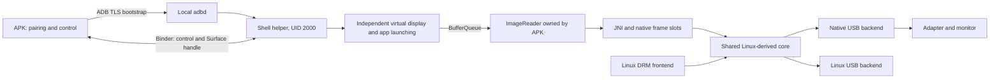

# Android 11+ virtual desktop: implementation specification

Date: 2026-10-22. Source baseline: `86f7c27` plus existing working-tree changes.
Status: **Implementation started in `android/`. Pairing, display, shared-core, USB, and hardware milestones remain pending.**

Current implementation checkpoint:

- **A00 partial:** the `android/` APK subproject, pinned Gradle wrapper, API/NDK
  configuration, and bounded wireless-debugging DNS-SD discovery are present.
  The embedded ADB pairing/TLS provider remains unresolved, and APK assembly
  has not been possible because this host has no Android SDK/NDK configured.
- **A01 pending:** app-side `ImageReader` and native owned-frame-buffer code
  exists, but no helper creates a virtual display or passes it a `Surface`.
  No independent app pixels or Binder lifecycle have been demonstrated.
- **A02 onward pending:** no Linux production source has been moved or changed
  for this Android work.

Read [binding decisions](#1-binding-decisions),
[process and IPC contracts](#4-process-boundaries-lifetime-and-communication),
then follow [implementation order](#13-implementation-order-and-acceptance-gates).
Sections 6–12 define the contracts each phase must satisfy; section 14 lists
the required checks. Do not begin with the Linux refactor.

This document replaces the earlier APK-only/public-API plan. The accepted design
uses an APK with **on-device wireless ADB pairing** to start a separate process
as Android's shell user. No root or computer is required for normal setup on a
compatible Android 11+ phone. Developer options, Wireless debugging, pairing,
and restarting the helper after reboot are part of the user setup.

## 1. Binding decisions

Implement these decisions unless the user changes the scope:

| ID | Decision |
|---|---|
| D01 | Minimum Android 11, `minSdk = 30`. Do not implement Android 4–10 compatibility. |
| D02 | Product target: one installable APK with pairing built in. An external Shizuku installation is not a release prerequisite. A development provider may be used for isolated experiments, but cannot satisfy the built-in-pairing acceptance gate. |
| D03 | One normal APK process owns USB permission, capture, JNI, conversion, and USB output. One ADB-started Java helper owns privileged display/app/input operations. |
| D04 | IPC carries control messages and a `Surface` handle. Raw frames stay in the APK process. No video codec, ADB frame stream, image compression, or network video server. |
| D05 | Reuse this repository's Linux C algorithms as shared production sources. Import no vendor Android Java, native library, resource, or bundled USB library. Use scrcpy as a correctness/architecture reference, not an implementation dependency. |
| D06 | First output path: SDR, RGBA capture normalized to BGRX, scalar UYVY, manual rectangles in transfer mode 3, one USB worker. |
| D07 | First desktop: one independent display with a fullscreen app and our own app-switching UI. Freeform windows and an OEM desktop launcher are optional capabilities, not an MVP prerequisite. |
| D08 | First release drives one selected physical adapter. Keep session state instance-owned; later multi-adapter support must not require removing singletons from pixel/transport code. |
| D09 | All privilege-sensitive calls stay in the helper. Calling `app_process`, JNI, or reflection from a normal APK does not itself change its UID. |
| D10 | No silent substitution of phone-screen mirroring or an own-UI-only screen when independent third-party apps fail. Report the actual missing capability. |
| D11 | No root, persistent system changes, global settings changes, force-stopping unrelated apps, or changing the phone's physical display mode to obtain desktop support. |
| D12 | Keep existing Linux behavior during extraction. Preserve current dirty files; do not reset, commit, reload a module, or run hardware-affecting experiments merely because this plan exists. |

The previous [source investigation](android-display-research.md) explains the
vendor APK's MediaProjection mirroring and scrcpy's ADB/shell implementation.
Android's [wireless debugging documentation](https://developer.android.com/tools/adb)
establishes pairing on Android 11+. Same-device bootstrap is demonstrated by
[Shizuku's setup](https://shizuku.rikka.app/guide/setup/); it still requires user
authorization and startup after reboot. Neither source establishes that every
OEM grants the display/input permissions needed by this project.

## 2. Definition of the first working product

The user can:

1. Install the APK, enable Wireless debugging, and pair from the phone.
2. Connect an adapter through USB host/OTG or a suitable powered hub.
3. Grant Android USB permission, select an advertised monitor mode, and start.
4. See a separate desktop/app on the attached monitor while the phone displays
   the control/trackpad UI.
5. Launch an exported launcher activity belonging to another installed app on
   the new display and interact with it.
6. Stop, unplug, reconnect, or reboot without leaving a stale display/helper.

A release is not complete until step 5 works on a real supported phone.
A pattern in our own Activity, a successful Binder call, or generated USB bytes
alone does not establish independent-desktop support.

MVP intentionally excludes audio, DRM/secure-content capture, arbitrary Unicode
text injection, multitouch, device-owner setup, screen-off/lock-screen operation,
adaptive scaling, GPU conversion, and multiple adapters. Preserve application
data when closing the display; do not use force-stop as a cleanup mechanism.

## 3. Repository layout and build contract

The following paths are **planned new files**, not files already implemented.
Use package names `io.github.ms912x.desktop`, `io.github.ms912x.helper`,
and `io.github.ms912x.ipc` for app, helper, and IPC.

```text
core/
  ms912x_core_types.h       # Explicit types, rectangles, views, statuses
  ms912x_core_protocol.[ch] # Reports, mode-3 headers/trailers, length validation
  ms912x_core_modes.[ch]    # Adapter mode records extracted from Linux
  ms912x_core_pixels.[ch]   # Scalar conversion and RGB565 masking
  ms912x_core_damage.[ch]   # Scan/coverage algorithms, added after full frames
  ms912x_core_batch.[ch]    # Compaction and previous-damage replay
  ms912x_core_scale.[ch]    # Existing scale algorithms, added later
  ms912x_core_simd/         # Extracted computational kernels, added later
android/
  settings.gradle
  build.gradle
  gradle.properties
  gradle/wrapper/
  app/
    build.gradle
    src/main/AndroidManifest.xml
    src/main/java/io/github/ms912x/desktop/
      MainActivity.java
      DesktopActivity.java
      DesktopSessionService.java
      SessionCoordinator.java
      HelperBootstrapProvider.java
      LocalAdbClient.java
      AdbEndpointDiscovery.java
      AdbIdentityStore.java
      HelperLauncher.java
      CaptureController.java
      UsbSessionController.java
      NativeSession.java
      InputForwarder.java
    src/main/cpp/
      CMakeLists.txt
      jni_session.c
      android_session.[ch]
      usb_libusb_backend.[ch]
      frame_slots.[ch]
    src/main/assets/        # Generated helper.jar, not a hand-maintained binary
    src/test/
    src/androidTest/
  ipc/
    build.gradle
    src/main/aidl/io/github/ms912x/ipc/
    src/main/java/io/github/ms912x/ipc/
  helper/
    build.gradle
    src/main/java/io/github/ms912x/helper/
      HelperMain.java
      HelperBinder.java
      ShellContext.java
      DisplayBackend.java
      ActivityBackend.java
      InputBackend.java
      BootstrapClient.java
  gradle/verification-metadata.xml
  DEPENDENCIES.md
tools/
  test_core.py             # Builds/runs the actual shared C sources on host
  android/                 # Build/validation helpers added only as needed
docs/
  android-driver-plan.md
  android-display-research.md
  android-validation.md    # Created during implementation; evidence per phase
```

Use Java in app/helper/IPC and C for the native core. Avoid a Kotlin runtime or
AndroidX dependency in the standalone helper. AIDL classes and parcelables must
be included in both app and helper builds from the same sources. Generate a
DEX-containing `helper.jar` with minimum API 30 and package it into the APK.
It must run through `app_process` without installing a second APK.

Define `:helper:assembleDexJar` to compile helper/shared IPC classes and run D8
with minimum API 30, producing `helper/build/outputs/helper.jar`. Make the app's
generated-assets task depend on it, calculate a SHA-256 build digest, and embed
both artifact and digest. A clean `:app:assembleDebug` must generate everything;
never require manually copying a helper from a previous build.

Initial build configuration: compile/target API 36, minimum API 30; record these
as the project's baseline, not a claim about the latest Android SDK. Select an
installed compatible Gradle/AGP/JDK combination and NDK r28 or newer during A00;
pin their exact versions and dependency checksums. If unavailable, report the
missing tools before installation. Follow the user's package-manager and
installation-approval preferences. Never use `+` versions or silently download
an unreviewed native binary. All included native dependencies must support
16 KB page-size devices; see [Android native page sizes](https://developer.android.com/guide/practices/page-sizes).

Build `arm64-v8a` first. Add `armeabi-v7a` before claiming support for
32-bit Android 11+ phones. Host C tests use the host architecture. An emulator
can validate framework behavior but cannot validate real adapter output.
The Linux module remains buildable using the existing root Makefile.

### 3.1 Dependency decision that must be resolved in A00

Built-in pairing needs the actual Android 11 wireless ADB pairing/TLS protocol,
not just legacy RSA ADB on port 5555. Evaluate a maintained embedded provider
against the required operations: persist identity, pair, TLS-connect, open a
shell stream, and transfer the helper artifact. Record exact source revision,
license, transitive dependencies, API/ABI minimums, and a real pairing result.

[libadb-android](https://github.com/MuntashirAkon/libadb-android) is a functional
candidate with pairing support, **not an approved dependency choice**. Its
[documented license choices](https://github.com/MuntashirAkon/libadb-android#license)
are GPL-3.0-or-later or Apache-2.0, while the reused driver files are
`GPL-2.0-only`. Do not assume direct integration is permitted, relicense our
driver, or copy pairing cryptography to avoid this question. Resolve the exact
integration/dependency arrangement before importing it. Preserve all notices.

If the selected provider cannot satisfy both integration requirements and
pairing on a real phone, mark A00 incomplete with the specific reason. A
temporary external provider may prove the display/IPC design while this is
resolved, but the release target and A01 gate still require built-in pairing.
This is a bounded prerequisite, not a reason to implement ad-hoc cryptography.

Implementation has identified [DroidMux](../android/DEPENDENCIES.md) as another
candidate: its current project advertises Android 11 pairing and dual MIT /
Apache-2.0 licensing. It remains unselected until the Android ABI, complete
dependency notices, source maturity, and real-phone pairing are verified.

## 4. Process boundaries, lifetime, and communication



| Resource | Owner | Release condition |
|---|---|---|
| ADB key/certificate | APK identity store | Explicit unpair/reset; excluded from backups/logs |
| Pairing code | Short-lived pairing operation | Immediately after success/failure; never persisted |
| ADB connection/bootstrap stream | APK service | Session stop, connection failure, or app death |
| Helper process and Binder | Shell helper | Stop command, app Binder death, ADB EOF, or watchdog |
| VirtualDisplay | Helper | Session teardown; APK activity recreation must not release it |
| ImageReader and Surface producer handle | APK capture controller | Helper detaches/releases display before reader destruction |
| Captured Image | Capture callback | Always closed in `finally` after synchronous native copy |
| Native snapshots, baseline, encoded payload | APK native session | After capture is quiesced and native worker joins |
| Java UsbDeviceConnection | APK USB controller | After native USB teardown |
| Duplicated USB fd, libusb context/handle/claim | Native USB backend | After I/O stops, claim release, and libusb close |

Never parcel an Image, pixel array, native pointer, or frame payload over Binder.
Pass the ImageReader Surface to the helper using Binder/AIDL. Cross-process
Surface/BufferQueue use is a **required A01 prototype result**, not an assumed
working implementation. Do not replace this with screenshot polling if it fails.

### 4.1 Session identity and helper bootstrap

Use a monotonically changing `sessionId` and 64-bit `geometryGeneration`.
A session also has a new random 256-bit bootstrap token. IDs are not secrets;
the token is. Reject protocol/build mismatches and messages for another session.

Bootstrap sequence, in this exact order:

1. From a visible activity, obtain USB permission and start the connected-device
   foreground session service. Keep pairing setup separately usable without USB.
2. Establish the local authenticated ADB connection and verify `id -u` returns
   2000. Reject root or an ordinary app UID; do not attempt privilege elevation.
3. Transfer the build-generated helper through the provider's file-transfer
   capability into a shell-owned directory beneath `/data/local/tmp`.
   Use a digest-derived fixed filename and verify its digest after transfer.
   Do not make app-private data directories readable to shell.
4. Launch the helper using a fixed command template equivalent to:
   `CLASSPATH=<verified-helper.jar> app_process / io.github.ms912x.helper.HelperMain`.
   Use a quoting function for every shell argument; package names or paths must
   never become unescaped command text.
5. Send session ID, expected app UID, provider authority, build/protocol IDs, and
   bootstrap token through the shell stream's stdin. Keep token/key material out
   of process arguments, logcat, stdout, persistent files, and crash diagnostics.
6. Helper verifies its real UID, prepares its Looper/control thread, and obtains
   framework service handles. It uses the existing shell identity and correct
   shell package/attribution context; it does not impersonate a system UID.
7. Helper registers its Binder with the APK's dedicated bootstrap ContentProvider.
   Provider accepts only calling UID 2000, the current one-use token, matching
   build/protocol/session IDs, and an outstanding bootstrap attempt.
8. App links a death recipient to helper Binder. Helper links a death recipient
   to the app callback Binder. Clear the bootstrap token after successful attach.
9. App requests capabilities, then creates a native session/reader and starts
   display creation. Do not mark the desktop ready merely after Binder attach.

The helper is not a normal application process. Implement provider access through
a small tested ActivityManager/IContentProvider compatibility wrapper; do not
assume `ContentResolver` from a fabricated Context works on every release.
The bootstrap provider is exported only for this handshake, has no generic
shell/file operations, and rejects unrelated UIDs before processing payloads.
The helper Binder independently checks caller UID against the expected app UID
on every operation. Never treat an app-supplied package string as authentication.

Keep the ADB bootstrap stream open and consume its bounded output continuously.
For v1, stream EOF stops the helper/session; do not depend on undocumented
survival after Wireless debugging is disabled. Helper receives a heartbeat
every 2 seconds and releases its display/exits after 10 seconds without an app
heartbeat. Use monotonic time, a separate watchdog thread, and bounded queues.

### 4.2 AIDL contract

Define these parcelables in `android/ipc`. Keep fields explicit; do not send
an untyped Bundle for ordinary session operations:

| Type | Required fields |
|---|---|
| ProtocolInfo | protocolVersion, buildDigest, realUid, sdkInt |
| DisplaySpec | width, height, densityDpi, requestedDecorations, fixedOrientation |
| HelperCapabilities | displayCreateState, thirdPartyLaunchState, inputState, systemDecorationsState, trustedDisplayState, failureCode/detail; each state is UNKNOWN/SUPPORTED/UNSUPPORTED |
| DisplayInfo | sessionId, geometryGeneration, displayId, width, height, densityDpi, effectiveFlags |
| InputBatch | sessionId, geometryGeneration, displayId, sequence, at most 64 validated key/pointer records |
| HelperResult | sessionId, requestId, geometryGeneration, resultCode, bounded diagnostic detail |

```text
IDesktopHelper:
  ProtocolInfo getProtocolInfo()
  void attachSession(sessionId, appCallback)
  void probeCapabilities(sessionId, requestId)
  void createDisplay(sessionId, requestId, generation, spec, captureSurface)
  void launchActivity(sessionId, requestId, generation, displayId, component)
  void injectInput(inputBatch)
  void releaseDisplay(sessionId, requestId, generation)
  void heartbeat(sessionId)
  void stopSession(sessionId)

IDesktopCallback:
  void onCapabilities(sessionId, requestId, capabilities)
  void onDisplayReady(sessionId, requestId, displayInfo)
  void onOperationResult(helperResult)
  void onFatalError(helperResult)
```

Use asynchronous completion callbacks for operations that touch framework
services. Binder threads validate/enqueue and return; one helper control thread
orders create/launch/input/release. Only `getProtocolInfo` is a small
synchronous call. Heartbeats/watchdog must not wait behind a hung display call.
Check callback caller identity and session/generation before changing app state.
Limit pending helper operations to 64; coalesce pointer movement, preserve
button/key transitions, and reject overflow with an explicit result.

## 5. On-device pairing and connection state

LocalAdbClient hides the selected provider behind these operations:

```text
loadOrCreateIdentity()
discoverPairingEndpoint(timeout)
pair(localAddress, pairingPort, sixDigitCode)
discoverConnectEndpoint(timeout)
connect(localAddress, connectPort)
executeFixedCommand(commandId, validatedArgs)
pushHelper(localAsset, remoteFixedPath, expectedDigest)
openHelperStream(validatedLaunchSpec)
disconnect()
forgetIdentity()
```

Do not expose arbitrary shell commands to the UI or helper Binder.

1. Launch Developer options using Android settings intents. Explain that the user
   enables Wireless debugging and opens its pairing-code dialog.
2. Discover `_adb-tls-pairing._tcp` while that dialog is open. Offer manual
   local address/port entry if discovery is unavailable.
3. Accept the six-digit code through split-screen setup or notification
   RemoteInput, so opening our UI does not dismiss Android's pairing dialog.
4. Complete authenticated pairing. Persist the provider-compatible key and
   certificate in app-private storage, using Keystore protection where supported
   by the provider. Mark them excluded from cloud/device backup.
5. Independently discover `_adb-tls-connect._tcp` and connect. The pairing
   port is not the connection port. Never assume either is 5555 or remains
   stable after restarting Wireless debugging or changing Wi-Fi.
6. Restrict endpoints to loopback or addresses currently assigned to this phone.
   Reject another LAN device; do not scan the network. Validate numeric address,
   address family, local interface/scope, and port range.
7. Use existing identity for reconnect. On revoked authorization request pairing;
   on connection failure rediscover the port before showing manual entry.
8. After reboot the helper is stopped. Retain pairing identity when still valid,
   show a user-started reconnect flow, and never promise automatic boot startup.

Suggested initial deadlines: discovery 15 s, TCP connect 5 s, pairing 60 s,
helper handshake 15 s. Every operation supports cancellation. Retry discovery
once after an explicit transient failure; no infinite retries or rapid polling.
Validate network discovery/permission behavior at the pinned target SDK,
including newer Android versions' local-network restrictions.

An ADB connection alone proves neither Surface transport nor desktop permission.
Store these as distinct capabilities/states in diagnostics. Shizuku may be used
as a development reference for bootstrap lifetime; it is not a mandatory
end-user dependency or permission inherited by the normal APK.

## 6. Helper display, application, and input backends

All wrappers belong in `android/helper`. Resolve methods once, cache the
chosen signature, and return the actual exception/result on failure. Test each
supported signature on its Android release. Do not catch an exception and
return success, hard-code Binder transaction numbers, or globally disable
hidden-API restrictions in the normal APK.

### 6.1 Display creation and capability probes

1. Helper creates a correctly attributed shell context and resolves the framework
   DisplayManager service. Verify actual Binder caller identity remains shell.
2. APK creates a 1280x720 RGBA ImageReader with `maxImages = 3` for the first
   desktop prototype and sends its Surface to `createDisplay`.
3. Start with public, presentation, own-content-only semantics. Never request
   auto-mirror. Initial logical orientation is fixed landscape; rotating the
   phone must not resize/reconfigure the external desktop.
4. On API 30–32, probe the legacy shell display/launch path without assuming the
   newer flag combination works. On API 33+, probe the trusted-display path.
   Request only flags whose permission and behavior have been verified.
5. Decorations, independent focus, display groups, and IME policy are separate
   optional capabilities. Do not blindly OR every scrcpy flag into every OS.
   In particular, always-unlocked behavior is excluded from v1.
6. Query effective display ID, dimensions, density, flags, and actual creation
   result. Report these to the app with the session/generation.
7. App launches its DesktopActivity there through the helper. Render a moving
   frame number and RGBA color pattern; show a different pattern on the phone.
   Read pixels back in the APK and verify the two displays are independent.
8. Launch a distinct-UID test application or a user-selected exported launcher
   activity there. Verify its actual display ID and captured output.
9. Exercise key/pointer injection and return per-capability results.

Capabilities use `UNKNOWN / SUPPORTED / UNSUPPORTED` plus a reason and
test evidence; retain these three states in the transport parcelable.
Method availability or a granted permission is only preflight evidence.
The third-party launch state becomes supported only after an actual
cross-app launch on our created display. Keep preflight and observed results
separate in the implementation.

If trusted-display creation is denied, a legacy shell path may be probed.
It is accepted only when the independent third-party-app and input gates pass.
If they fail, stop with `DISPLAY_PERMISSION_DENIED` or the precise result.
Do not change to MediaProjection, reuse the default display, or claim that a
Presentation-only success satisfies desktop support.

System decorations may be missing even when apps work. DesktopActivity supplies
our own app picker/workspace in that case. Never force-enable global freeform
mode, change physical-screen resolution, or switch the user's default launcher.

### 6.2 Launching and navigating apps

- Resolve launchable exported activities in the APK through PackageManager using
  an ACTION_MAIN/CATEGORY_LAUNCHER visibility query. Do not request unrestricted
  package visibility merely to show the app picker.
- Pass a validated ComponentName and our display ID to the helper.
- Helper verifies this ID belongs to the active session, resolves the activity,
  constructs `ActivityOptions.setLaunchDisplayId()`, and launches through
  its ActivityManager wrapper with the shell identity.
- Return the framework result and actual observed display where available.
  Single-instance apps may move or reuse a task, and apps may reject secondary
  displays; show a specific unsupported-app result rather than repeated launches.
- Do not promise simultaneous independent copies of an arbitrary application.
- Our Home action explicitly launches DesktopActivity on the session display.
  Back is a targeted key action. Do not send an unqualified HOME intent that
  could move the physical phone's UI instead.
- On display release, allow Android's normal task migration/cleanup. Do not set
  destroy-content flags or call forceStopPackage as a workaround. Record what
  happens on each OS before claiming task-preservation behavior.

### 6.3 Input contract

MVP input consists of a phone trackpad, primary/secondary pointer buttons,
scroll, Back/Home actions, and key events from the phone control activity.
External Bluetooth/USB keyboard and mouse routing is a separate measured case.

For every forwarded event:

1. Check session, generation, and display ID. Drop stale events without retargeting.
2. Map phone control coordinates into virtual-display coordinates; use desktop
   width/height, not physical monitor timing dimensions after optional scaling.
3. Construct a fresh event with monotonic timestamps and a valid down/up sequence.
4. Assign the virtual display ID through the helper's InputEvent wrapper and call
   InputManager injection as shell. Check the returned result.
5. Recycle framework events and release pressed keys/buttons on focus loss,
   reconfiguration, cancellation, or session stop.

Coalesce pointer moves but never discard a required down/up transition.
Do not forward an external hardware event twice if Android already delivered it
to the desktop. Probe physical-device focus and IME separately. Do not implement
Unicode by feeding UTF-8 bytes to KeyEvent or assume the phone IME can commit text
to another process through our ordinary app.

Verify whether Android's captured surface contains the pointer. If it does not,
add a software pointer using the shared Linux cursor-composition routines in
A08, repairing both previous and new cursor coverage. Do not accidentally draw
two pointers or require an overlay permission merely to draw our USB output.

## 7. APK lifecycle and state machines

The single SessionCoordinator runs on its own HandlerThread and is the only
owner allowed to mutate session state. Activity, USB broadcast, Binder callback,
capture callback, and native completion handlers enqueue events to it.

```text
ADB setup:
  UNPAIRED -> PAIRING -> PAIRED -> CONNECTING -> ADB_READY
  revoked -> UNPAIRED
  changed endpoint -> CONNECTING after rediscovery

Desktop session:
  IDLE -> PREPARING -> BOOTSTRAPPING -> CONFIGURING -> STREAMING
  STREAMING -> RECONFIGURING -> CONFIGURING -> STREAMING
  any active state -> STOPPING -> IDLE or ERROR
```

Pairing is usable from a visible activity without an adapter. The desktop
foreground service starts only after normal USB permission has been obtained.
For MVP use split-screen pairing; notification RemoteInput is optional and must
not start an otherwise ineligible background/foreground service.

Manifest requirements:

- Minimum API 30, USB host feature, INTERNET for local ADB, network-state access
  only as actually needed for endpoint discovery, and version-correct runtime
  network permissions when targeting releases that require them.
- FOREGROUND_SERVICE and, on relevant target/OS combinations,
  FOREGROUND_SERVICE_CONNECTED_DEVICE; session service type `connectedDevice`.
- A stop action in the persistent notification. Handle notification permission
  on Android 13+ without confusing denial with USB/display permission.
- MainActivity is exported as the normal launcher. DesktopActivity is also
  exported, without a generic intent filter, because the separate shell UID
  launches it explicitly. Its onCreate must verify an active session and that
  its actual display ID matches that session; otherwise finish immediately.
  DesktopSessionService is not exported. The narrow bootstrap provider is
  exported with the checks in section 4; no other IPC service is exported.
- Dynamic USB permission result receiver uses an app-specific action, explicit
  package, version-appropriate PendingIntent/receiver flags, and validates the
  device and outstanding request. Do not accept an unsolicited broadcast as
  proof that USB permission was granted.
- No root, WRITE_SECURE_SETTINGS, QUERY_ALL_PACKAGES, SYSTEM_ALERT_WINDOW,
  AccessibilityService, or MediaProjection dependency for the MVP.

Use [foreground-service requirements](https://developer.android.com/develop/background-work/services/fgs/service-types)
for the pinned target/OS. Keeping a service in the foreground does not grant
shell or display privileges. Starting a pairing operation while Settings is
visible must respect the actual service/background state.

### 7.1 Ordered startup

1. Verify OS/USB host features and establish the user's local ADB authorization.
2. Select a physical adapter from the Linux driver's supported IDs, validate its
   descriptors, and obtain USB permission.
3. Start foreground session service from the visible activity.
4. Start/authenticate helper and probe required framework capabilities.
5. Open/claim USB through native backend; detect chip/SDRAM, sink, EDID, modes.
6. Choose an adapter-supported and sink-supported fixed mode. Bring-up starts at
   native scale 100; use 1280x720@60 where available, otherwise a validated mode.
7. Allocate bounded native buffers and ImageReader for that exact input geometry.
8. Create helper display with the reader Surface and wait for its actual result.
9. Program adapter using the shared Linux-derived mode/control sequence.
10. Launch DesktopActivity, enable accepting images, send initial full refresh.
11. Launch the selected third-party app and enable input after display readiness.
12. Mark STREAMING only after desktop creation, pixel acquisition, and a complete
    USB logical batch have succeeded. Physical presentation remains a separate
    observed test result, not an automatic inference from USB completion.

Failures unwind only resources acquired so far, in reverse dependency order.
Use idempotent cleanup at every partial-initialization boundary.

### 7.2 Stop and reconfiguration

On Stop, detach, helper death, ADB EOF, or fatal USB error:

1. Mark STOPPING and prevent new input/capture publications.
2. Stop ImageReader callbacks and join in-progress capture-copy work.
3. Stop/cancel native work and join the USB worker while its fd/buffers are valid.
4. Ask helper to release the display; on helper death its owner process teardown
   handles this. Keep the ImageReader alive until release/death is confirmed.
5. Close reader/Surface and free native frames/requests.
6. Release native interface claim, libusb handle/context, and duplicate fd.
7. Close Java connection and finish helper/bootstrap stream/service state.

The native worker can release its I/O resources before frame buffers at step 5,
but the Java connection must outlive all native I/O and teardown. Record the
actual ownership path in code; cleanup must not depend on Java finalization.

A resize/format/mode change uses an explicit RECONFIGURING reservation:
disable producers, finish/cancel the active logical batch, increment generation,
discard pending work, release old helper display/reader, reprogram the adapter,
create the new reader/display, clear baselines/replay, then require a full frame.
Initial implementation may visibly restart the desktop. Seamless task-preserving
resize is later work and must not be simulated by reusing stale buffers.
Do not claim zero-disruption resize.

Keep old memory allocated until capture copies and native work referencing it
have stopped. Check generation both when reserving a capture slot and when
publishing it after copying. A single ordered USB queue is not a producer barrier.

## 8. Shared C core: exact extraction boundaries

The shared core is a source library compiled separately into the kernel module,
host tests, and Android JNI library. It has no runtime dependency on a loaded
kernel module, libdrm, Java, Binder, libusb, workqueues, sysfs, or debugfs.

| Current source | Extracted responsibility | Keep platform-specific |
|---|---|---|
| `ms912x_protocol.h`, report builders in `ms912x_registers.c` | Bytes, opcodes, endian serialization and validation | USB calls, locks, DRM/device lifetime |
| `ms912x_mode3.h`, encoding in `ms912x_convert.c` | Header/trailer encoding and size calculation | Backend selection, request queue |
| Mode records in `ms912x_kms.c` | Adapter mode/timing table in one shared source | DRM mode objects, connector publication |
| `ms912x_color.h`, scalar conversion loops | Existing XRGB/BGRX-to-UYVY arithmetic | CPU/FPU entry and device state |
| `ms912x_rgb565.h` | Packed RGB565 mask and scalar output | Kernel ISA dispatch |
| `ms912x_scan_methods*`, scan loops in `ms912x_damage.c` | Comparison and scan coverage | Snapshot locks, work publication |
| `ms912x_scan_rects*`, `ms912x_batch.c` | Rectangle collection/compaction/replay | Allocation ownership and kernel sort binding |
| `ms912x_downscale*`, scale/profile/damage policy headers | Existing filters and pure decisions | Module params and per-device sysfs |
| Selected `ms912x_payload.c`/transfer invariants | Shared validation where it remains genuinely pure | Full kernel lifecycle/scheduler |

### 8.1 Core types and interfaces

Use a single types header that maps prefixed fixed-width types to kernel types
under `__KERNEL__` and standard C types in userspace. No fake `linux/`
header tree or copying `struct ms912x_device` into Android. Keep rectangle
coordinates signed 32-bit and half-open; convert DRM rectangles in Linux
wrappers instead of assuming a cast is ABI-safe.

Required logical types:

```text
CoreRect: x1, y1, x2, y2                         # x2/y2 exclusive
CoreFrameView:
  data, capacityBytes, width, height, rowStrideBytes, pixelLayout
CoreGeometry:
  desktopWidth/Height, inputWidth/Height, outputModeId, scaleMode, wireFormat
CoreBatch:
  encodedBytes, encodedLength, encodedCapacity, currentDamage, fullCoverage
CoreStatus:
  OK, INVALID_ARGUMENT, CAPACITY, OVERFLOW, UNSUPPORTED
```

Initial pixel layouts: BGRX8888 and later packed little-endian RGB565.
RGBA normalization belongs to the Android input adapter. Core functions must
accept explicit pitch, including Linux's existing fixed-pitch snapshot wrapper.
Remove every hidden `MS912X_MAX_WIDTH` stride assumption from extracted loops
and SIMD entry points before accepting arbitrary Android pitch.

The exact C names may use the `ms912x_core_` prefix, with these contracts:

```text
build_control_report(command, parameters, output[8]) -> status
build_read_report(address, output[8]) -> status
mode3_encoded_size(rectangles, count, wireFormat) -> status + checked size
encode_batch(view, rectangles, count, wireFormat, dst, capacity) -> status + used
scan_damage(baseline, newest, policy, scratch, outputRectangles) -> status + count
build_replay_batch(currentDamage, previousDamage, budget, output) -> status
scale_frame_or_region(source, destination, geometry) -> status
```

Validate all geometry/length arithmetic before writing an encoded batch.
On failure the caller sends nothing and treats `used = 0`; no partial payload
may leak into a USB submission. Caller owns allocations/scratch and serializes
calls. No per-frame allocation hidden inside conversion or scan functions.

Move algorithms once and make both production platforms call the moved code.
Do not leave the Linux implementation active while Android builds a slightly
different duplicate. Refactor existing tests that scrape function text when
moves require it; keep their behavior coverage. Benchmark no-op FPU/lock shims
are not valid production portability wrappers.

### 8.2 Protocol details that must survive extraction

- Initial mode is `MANUAL_BLOCK = 3`. No vendor Android frame-mode buffer
  switch/ZLP sequence and no mode mixing.
- Control reports are 8-byte HID-style feature reports: OUT setup type 0x21,
  request 0x09, value 0x0300; paired reads use IN 0xA1/request 0x01.
- Retain the current Linux report index value 0 for validated devices. Discover
  and claim the display interface; do not silently substitute its enumeration
  index into report fields without protocol evidence.
- XDATA read report opcode is 0xB5; returned byte is report offset 3. Keep SET/GET
  as one serialized logical operation. Require exact report lengths.
- Each mode-3 rectangle has 8-byte header, two bytes/pixel for UYVY/RGB565, and
  8-byte trailer. Header marker is FF00; x:y and width:height use packed 12-bit
  big-endian fields. Reject out-of-range geometry instead of truncating it.
- Intermediate rectangles end with `FF 80 00 00 00 00 00 00`; only the
  final rectangle ends with `FF C0 00 00 00 00 00 00`.
- Require valid, clipped, nonempty rectangles with even x and width, preserving
  the Linux driver's stronger alignment where needed. Validate frame edges.
- Adapter timing IDs are not interchangeable with standard HDMI/CTA VIC numbers.
  Preserve the Linux table: e.g. 1280x720@60 uses 0x4F and 1920x1080@60 uses 0x81.
- Preserve the actual Linux VIDEO_OUT command semantics. Its width/height fields
  currently contain input geometry and its output-format byte is 0x01. Do not
  replace these with monitor dimensions or UYVY's 0x22 because names seem clearer.
- Preserve `0xF7FE` masking for packed RGB565 wire pixels. Do not apply this
  16-bit mask directly to RGBA/BGRX source words.
- Rectangle capacity and allocation budgets are host policy, not proven device
  maximums. USB chunk boundaries do not add trailers or split logical updates.

For Android initial configuration, reproduce the existing Linux modeset
semantics: normal power/SDRAM prerequisites, stop transmission, read required
state, select mode 3, program VIDEO_IN and VIDEO_OUT, start transmission, and
enable video. Extract the authoritative builders/sequence from current code;
fixtures compare its exact reports. Do not invent register writes or copy the
vendor APK initialization sequence.

EDID transport and checksum/header handling may be extracted, but do not link
the DRM EDID parser into Android. Add a bounded userspace parser for base-block
established/standard/detailed timings and the CTA video modes needed for the
initial mode intersection. Limit extensions to the existing cache bound and
validate every block length/checksum. Map full timing records to the shared
adapter table; never equate EDID VIC bytes with adapter VIC bytes. A corrupt or
missing EDID needs a clearly labeled manual mode choice, not arbitrary timings.

## 9. Capture, JNI, buffers, and incremental image correctness

### 9.1 Capture callback and JNI contract

ImageReader runs on a dedicated capture HandlerThread. Use RGBA_8888 and three
slots. [ImageReader ownership](https://developer.android.com/reference/android/media/ImageReader)
requires acquired Images to be closed and sufficient free slots for
`acquireLatestImage()` to discard older images.

```text
NativeSession.create(usbFd, interfaceDescriptor, geometry, nativeBudget) -> handle
NativeSession.offerRgba(handle, generation, sequence, timestampNs,
                        directBufferSlice, cropX, cropY, width, height,
                        rowStrideBytes, pixelStrideBytes) -> ACCEPTED | DROPPED | error
NativeSession.reconfigure(handle, newGeneration, geometry) -> async result
NativeSession.getStats(handle) -> immutable snapshot
NativeSession.stop(handle) -> stops producers and joins I/O
NativeSession.destroy(handle) -> releases memory and invalidates handle
```

`offerRgba` synchronously copies/normalizes the selected source pixels into
an owned native frame slot. It never waits for conversion, USB completion, or
helper calls. After it returns, native code must not retain the Java buffer
address. Reject an invalid/stopped/stale handle using a checked handle registry,
not an unchecked `jlong` pointer cast that can race with destruction.

On every capture callback:

1. Acquire the latest image; if null, return.
2. In `try/finally`, verify the expected geometry/generation, RGBA format,
   crop, and plane count. For v1 require four-byte pixels; reject unsupported
   layouts explicitly.
3. Use a sliced direct buffer whose base starts at its valid position. JNI must
   not assume `GetDirectBufferAddress` includes a Java buffer's position.
4. Validate with checked arithmetic that the final requested RGBA pixel fits:
   `(cropY + height - 1) * rowStride + (cropX + width - 1) * pixelStride + 4`
   must not exceed the accessible plane capacity. Do not read padding after the
   last row; some buffers do not include it.
5. Apply the initial 10-images/s offer limit using monotonic time, but continue
   acquiring/closing skipped Images so the producer cannot stall.
6. Offer the frame; treat DROPPED as backpressure, not a fatal error.
7. Always close the Image in `finally`, including exception/drop paths.

RGBA bytes are R,G,B,A. The Linux little-endian XRGB conversion expects B,G,R,X
bytes. Normalize explicitly into the canonical BGRX view; do not reinterpret
one as the other, ignore red/blue test failures, or use alpha as a color channel.
Start with opaque SDR patterns and verify range/color arithmetic against the
existing Linux conversion. HDR/wide-gamut behavior is outside the MVP claim.

### 9.2 Slot ownership and queue bounds

Allocate two source slots, one baseline frame, one encoded batch buffer, and
bounded scan/replay scratch at configuration time. Source states are:

```text
FREE -> FILLING -> PENDING -> ACTIVE -> FREE
                     |
                     +-- replaced by a newer FILLING/PENDING snapshot
```

Rules:

- Under the pool mutex, reserve a FREE slot or an unclaimed PENDING slot and mark
  it FILLING. Never overwrite ACTIVE or another FILLING slot.
- Copy without holding the queue mutex. Reacquire it to publish only if the
  session/generation still matches. Otherwise discard and release the slot.
- Worker claims only a complete PENDING slot and marks it ACTIVE before scanning.
- At most one ACTIVE frame and one replaceable newest frame exist. If neither
  source slot can be reserved, return DROPPED.
- All encoded pixels come from the same immutable ACTIVE snapshot. Never fetch
  some rectangles from a subsequently published frame.
- Keep the ACTIVE frame and encoded bytes valid through the final USB chunk.
- Do not hold the pool mutex while copying an entire image, converting, making
  Binder calls, sending controls, or waiting for USB.

Initial native frame-pipeline allocation ceiling: 64 MiB per session, including three
canonical image buffers, encoded payload, scratch, and rectangle vectors.
Initial maximum geometry is the existing Linux limit, 1920x1200; this is project
policy, not a hardware maximum. Reject configurations exceeding either bound.
Account separately for ImageReader/gralloc, Java, and compositor memory; do not
claim the process's total memory is bounded by the pipeline limit. Library
internals and native thread stacks also belong in process-memory measurements.

Compute the worst encoded size with checked arithmetic. If rectangle overhead
would exceed the allocated payload or count budget, merge/collapse to a valid
bounding/full-frame rectangle without losing required coverage. Do not simply
truncate the rectangle list. Close the old reader before allocating its
replacement once the old display/callbacks are quiesced.

### 9.3 Baseline and replay rules

First implement full-frame updates with no scan. Then add exact damage
comparison with row stride 1 and tolerance 0. Lossy sampling/tolerance and
adaptive policy stay disabled until their correctness tests exist.

The baseline represents source pixels whose encoded regions completed
transmission, not the latest captured frame. For each update:

1. Claim immutable newest frame F.
2. If the baseline is invalid, choose a full-frame current-damage rectangle.
   Otherwise compute current damage D against the completed baseline.
3. Assemble the batch from D plus the previous completed update's current damage
   P, using current pixels from F for both. Store D separately from the merged
   transmit coverage. P is not the previous encoded byte buffer.
4. Encode and transmit the entire logical batch in order.
5. On complete success in the same generation, copy only transmitted source
   coverage from F into the baseline, then set P to this update's D.
6. On failure/cancellation, do not advance baseline or replay state. Invalidate
   them and require a full refresh after transport reinitialization.
7. Release ACTIVE, then choose the newest pending frame.

Skipping frames must not lose edits. Example: baseline has a white desktop;
frame A changes one pixel to black; frame B retains that black pixel and adds
another; A is dropped. B must still transmit both changes against the baseline.

Do not blindly swap the entire captured image into the completed baseline after
a partial or sampled update: untransmitted pixels would then disappear from
future damage detection. The exact first implementation may optimize a proven
full-frame replacement later.

After a change becomes idle, perform one replay-only batch from the last P with
the latest coherent pixels, then clear P on success. Otherwise a final small
change could remain unrepaired merely because no new ImageReader image arrives.
Prefer an already pending complete snapshot. If none exists, the worker may use
the completed baseline as its immutable source for that idle repair: all pixels
in P came from the last successful update. No capture thread writes the baseline,
and the single worker must not modify it while this repair is in flight.
A03/A06 hardware tests determine whether additional startup/full-repair repeats
from the current Linux policy are needed; do not invent a device page model.

When D and P are both empty, send nothing unless an explicit full-refresh
request is pending. RGB565 comparison must account for packing and wire-mask
semantics if optimized later; using conservative full RGB comparison is correct
but may send extra updates.

## 10. Native USB backend and mode selection

The normal APK uses UsbManager to enumerate/open the device after user consent.
Native code receives the authorized fd, makes its own close-on-exec duplicate,
and wraps it through upstream libusb with discovery disabled.
[Android's descriptor API](https://developer.android.com/reference/android/hardware/usb/UsbDeviceConnection#getFileDescriptor())
and [libusb handle wrapping](https://libusb.sourceforge.io/api-1.0/group__libusb__dev.html)
support this arrangement; OEM acceptance remains a hardware gate.

Required backend operations:

```text
openAuthorizedFd(fd, expectedDeviceIdentity, interface, endpoint)
controlExact(setup, buffer, expectedLength, deadline)
bulkWriteAll(endpoint, immutableBytes, length, deadline)
requestStop()
close()
```

- Build USB filters/ID recognition from the Linux driver's current `id_table`,
  not the vendor APK's narrower filter. Verify actual configuration/interface
  and a bulk OUT endpoint; expected endpoint address is 0x04 for the supported
  current devices. Reject ambiguous/incompatible layouts explicitly.
- Native backend is the sole interface-claim owner. Java does not also claim it.
  Claim only the display interface and leave audio/HID interfaces alone.
- Do not blindly detach a kernel driver or reset the entire USB device when a
  claim fails. Report ownership conflict; an explicit validated recovery can be
  added later.
- Keep one worker responsible for control sequences and logical frame writes.
  A register SET/GET pair and a mode change cannot interleave with image bytes.
- Start with synchronous bulk transfers split into at most 64 KiB chunks.
  Chunking changes USB submission size only, not mode-3 framing.
- Reuse Linux control timeout/retry semantics: 1000 ms per operation, up to two
  retries for the classified transient failures, with stop checks between
  operations/retries. Do not retry detach as a transient failure.
- Initial bulk timeout is 250 ms per chunk, with a 10 s logical-batch deadline.
  Check stop between calls. Never use an infinite timeout.
- Advance by actual bytes transferred. A successful short write resumes the
  remaining bytes of that same immutable stream; zero progress is an error.
  On timeout/error after partial progress, treat the logical batch as failed;
  do not blindly resend its header or complete it using a different frame.
- Failure invalidates baseline/replay, performs one bounded device/session
  reinitialization attempt, and requires a full refresh. A repeated failure
  stops with a useful error. No infinite reset loop.
- Close order: stop/join I/O, release our claim, libusb_close, close duplicate fd,
  libusb context teardown, then let Java close its original connection.
  Audit the exact chosen libusb ownership contract so every fd closes once.

Select output mode from the intersection of validated sink EDID timings and
the shared adapter table. Default preference is 1280x720@60, then the next
validated lower-bandwidth mode available. A manual selection is permitted for
a monitor with unreadable EDID, but it must come from the adapter table and be
reported as a user override, not an EDID-confirmed mode.

Use native input geometry equal to desktop geometry initially. Keep monitor
refresh rate separate from image update rate: 60 Hz output timing with a 10 Hz
initial capture/offer limit is valid. Later damage updates can improve desktop
responsiveness without pretending full-screen USB bandwidth equals 60 FPS.

## 11. RGB565, scaling, SIMD, and performance follow-up

Implement only after the full scalar UYVY desktop is correct:

1. RGBA/BGRX-to-packed-RGB565 input path, shared existing 0xF7FE output masking,
   format-aware damage semantics, and byte-exact host fixtures.
2. Extract ARM NEON computational kernels and compile with NDK intrinsics.
   Kernel FPU entry/exit and `may_use_simd()` remain kernel-only wrappers.
   Do not import kernel FPU calls into userspace or use no-op locking as a port.
3. Reuse existing 2:1, 3:2, and 5:4 scaling filters and geometry policy, initially
   with explicit fixed scale selection. Dynamic/adaptive geometry is deferred.
4. Keep desktop, VIDEO_IN, and monitor VIDEO_OUT dimensions separate. Software
   downscale maps desktop to input; adapter timing selects monitor output.
   Input-event coordinates remain in desktop coordinates.
5. If pointer capture is missing, add the shared cursor-composition path with
   old/new coverage repair and ordered publication.
6. Consider GPU/hardware-buffer input only after measuring CPU copies. It needs
   separate synchronization, layout/color handling, and readback measurements.

Measure captured images/s, accepted/dropped images/s, completed logical
updates/s, payload MB/s, conversion Mpixel/s, queue age/latency in ms, native
allocation bytes, process memory, and target-phone thermal/CPU behavior.
Count USB chunks separately. USB completion is not display presentation.

For reference, a 1920x1080 full update at two bytes/pixel is 4,147,200 pixel
bytes; 30 such updates/s require 124,416,000 bytes/s before headers/trailers.
Use actual link measurements and damage rates to choose defaults. Do not make
phone performance claims from the existing host's SIMD benchmark alone.

## 12. Errors, diagnostics, and evidence

Use explicit stable error codes, with a bounded human-readable detail and the
phase/operation that failed:

```text
ANDROID_UNSUPPORTED       PAIRING_REQUIRED       PAIRING_FAILED
ADB_ENDPOINT_UNAVAILABLE  ADB_AUTH_REVOKED        HELPER_START_FAILED
HELPER_PROTOCOL_MISMATCH  HELPER_DIED             HELPER_TIMEOUT
DISPLAY_CREATE_FAILED    DISPLAY_PERMISSION_DENIED
APP_LAUNCH_DENIED         APP_WRONG_DISPLAY      INPUT_DENIED
USB_PERMISSION_DENIED    USB_INTERFACE_BUSY      USB_UNSUPPORTED_LAYOUT
USB_DETACHED             USB_SHORT_TRANSFER     USB_TIMEOUT
EDID_INVALID             MODE_UNSUPPORTED       SDRAM_UNSUPPORTED
FRAME_LAYOUT_INVALID     FRAME_STALE            FRAME_BUDGET_EXCEEDED
```

DROPPED is a counter/status, not a fatal error. FRAME_STALE is expected during
a cancelled transition; repeated stale frames during stable streaming are a bug.

Diagnostics include app/helper build IDs, Android SDK/build fingerprint, ABI,
page size, helper real UID, capability states, effective display flags and ID,
all three geometries, wire format, adapter VID/PID/interface/endpoint, EDID
selection or manual override, generation, and the counters above. Record exact
framework exceptions and USB return/actual-length information.

Do not log ADB private keys, pairing codes, bootstrap tokens, app content, or
raw frames. Exports are user-triggered, redact secrets, and distinguish
configuration, software-test results, and observed hardware behavior.

Create `docs/android-validation.md` during implementation with one entry per
phase: source/build IDs, commands, artifacts, device/build, steps, expected
result, actual result, pass/fail/pending, and remaining limitations. Use an
explicit synthetic image for reproducible capture tests. Never mark a phase
hardware-verified from a mock, emulator-only run, or a USB success return.

## 13. Implementation order and acceptance gates

Execute one phase at a time. Each phase needs a buildable result and recorded
evidence before the next dependent phase. A00–A01 intentionally precede the
shared-core migration; do not refactor the Linux driver before confirming the
Android privilege/capture design.

### A00 — Freeze dependencies and make built-in ADB bootstrap work

**Files:** Android build skeleton, LocalAdbClient, AdbEndpointDiscovery,
AdbIdentityStore, HelperLauncher, DEPENDENCIES.md, initial validation record.

Tasks:

1. Inspect the working tree and available tools; record existing unrelated edits.
2. Select/pin the build toolchain and resolve the embedded ADB dependency issue
   in section 3.1. Record a reproducible source build and transitive licenses.
3. Build an APK with pairing UI and a tiny helper that reports its UID/build ID.
4. Pair on the same Android 11+ phone, connect to the distinct connection port,
   transfer the helper, and launch it through the authenticated shell stream.
5. Implement cancellation, changed-port discovery, authorization revocation,
   persistent identity, reboot detection, and visible restart setup.

**Pass:** single APK, no root/computer/external provider, actual helper UID 2000;
wrong pairing code and revoked key fail cleanly; repeated startup reuses the key.
Do not mark complete from a Shizuku-only run or an external PC's ADB connection.

### A01 — Prove Binder Surface capture and independent apps

**Files:** IPC module, HelperBootstrapProvider, helper backends, CaptureController,
DesktopActivity, compatibility tests. No Linux extraction yet.

This prototype may stay in a visible activity without starting the desktop
foreground service or opening USB. Do not fabricate USB consent or bypass
foreground-service prerequisites merely to run the framework proof.

Tasks:

1. Complete the authenticated Binder bootstrap and death/heartbeat handling.
2. Pass an APK-owned ImageReader Surface into the helper through AIDL.
3. Create the separate display, render a numbered color pattern, and verify
   ImageReader receives pixels while the physical phone shows different content.
4. Launch another UID's exported Activity on it and verify the actual display.
5. Test one key, pointer down/up, unsupported app, and permission-denied paths.
6. Kill each side in turn; disconnect the ADB stream; verify cleanup/watchdog.
7. Record per-OS wrapper signatures and effective flags/capabilities.

**Pass:** independent third-party application pixels arrive in the APK process
without MediaProjection, ADB pixel traffic, root, or a PC. App/helper death leaves
no owned display. This is the hard feasibility gate. Stop dependent extraction
if it fails; report the exact permission/wrapper/Surface problem.

### A02 — Extract protocol/mode/scalar pixel core into production use

**Files:** core types/protocol/modes/pixels; Linux wrappers; root Makefile and
affected existing fixtures; tools/test_core.py.

Tasks:

1. Add portable types and explicit-pitch frame views.
2. Move report, mode-3 header/trailer, size, mode-table, and scalar UYVY logic.
3. Change Linux production wrappers to use the shared functions without changing
   chosen format, mode, scan defaults, cursor behavior, or scheduling.
4. Compile those same sources as a host library and Android JNI dependency.
5. Add byte/geometry tests listed in section 14 and adjust affected extraction
   fixtures to continue testing production code.

**Pass:** host tests and relevant existing Linux tests pass; kernel module builds;
baseline report/payload fixtures remain identical. No device reload is implied.

### A03 — Display native test patterns through the adapter

**Files:** UsbSessionController, NativeSession/JNI, libusb backend, geometry/mode
selection and EDID intersection, native session initialization.

Tasks:

1. Implement authorized-fd wrapping and single native interface ownership.
2. Probe adapter/SDRAM/sink, select a validated fixed native-scale timing.
3. Program the shared Linux control sequence and send generated native patterns
   through a complete full-frame mode-3 rectangle.
4. Verify RGB primaries, grayscale, checkerboard, frame number, first/last rows.
5. Inject short writes/timeouts in backend fixtures; unplug during actual I/O.

**Pass:** correct visible patterns on the physical monitor; partial initialization,
permission denial, claim failure, stop, and detach close every owned fd/buffer.
A successful bulk return without visible output is not this gate.

### A04 — Connect captured desktop frames to the full-frame native path

**Files:** capture/JNI frame slots, SessionCoordinator/service lifecycle,
bounded worker, instrumentation tests.

Tasks:

1. Implement synchronous RGBA-to-owned-BGRX offers with exact crop/stride checks.
2. Add two source slots, completed baseline storage, one payload buffer, initial
   10 Hz offer limit, and memory ceilings.
3. Send full-screen updates from a single immutable ACTIVE snapshot.
4. Connect the app/desktop launcher flow and handle Activity recreation.
5. Exercise start/stop, phone rotation, USB replug, helper death, ADB loss,
   reconnect, and app background/foreground transitions.

**Pass:** a third-party app on the virtual screen is visible through our adapter
while the phone remains independent. Memory/queue depth stay bounded, colors and
pitch are correct, and stop/reconnect do not require rebooting the phone.

### A05 — Extract damage and batching without changing Linux behavior

**Files:** shared damage/batch code, Linux adapters, host fixtures, Android worker.

Tasks:

1. Move row comparison, rectangle aggregation, byte budgets, and compaction from
   production Linux sources into shared code in small steps.
2. Keep exact Android scanning (stride 1, tolerance 0) initially.
3. Add current/previous damage vectors and transmitted-coverage baseline commit.
4. Add idle replay and full recovery after a failed/partial logical update.
5. Preserve all current Linux scan/policy semantics through its wrappers.

**Pass:** byte and image-state fixtures cover skipped/overwritten pending frames,
partial coverage, replay-only updates, stale generation, capacity collapse, and
transfer failures. Linux regression checks remain green.

### A06 — Validate incremental output on hardware

**Files:** focused diagnostics/fixtures and validation records; implementation fixes
only when a failure identifies a concrete issue.

Tests:

1. Change a single pixel, small window, scrolling text, then stop all animation.
2. Move a window repeatedly and switch between two unrelated applications.
3. Saturate capture while throttling the fake/real sender; final image must
   converge to the newest frame rather than omit changes from dropped frames.
4. Change resolution during capture/encoding and during a partially sent batch.
5. Stop/unplug at each request state and reconnect repeatedly.
6. Confirm idle replay and any inherited startup/repair policy using visible
   static patterns, not an inferred device page implementation.

**Pass:** no persistent stale regions, mixed frame/geometry payloads, unbounded
queue, use-after-free, hang, or misleading completion counters. Label actual
physical presentation observations separately from USB statistics.

### A07 — Finish input and usable app switching

**Files:** InputForwarder, helper input/activity wrappers, phone controls,
DesktopActivity, input fixtures.

Tasks:

1. Complete pointer buttons/scroll, key routing, targeted Back/Home, and app picker.
2. Test coordinate edges, held-key release, generation changes, denied injection,
   and physical keyboard/mouse focus without double forwarding.
3. Test applications with single-instance tasks, app-initiated activity launches,
   and unavailable secondary-display support.
4. Verify pointer capture. If missing, implement the cursor step in A08 before
   calling pointer interaction complete.

**Pass:** user can operate at least one real third-party app and return to the
workspace without manipulating the physical phone's unrelated UI. Document IME,
Unicode, single-instance, and focus limitations rather than hiding them.

### A08 — Add measured efficiency features

**Files:** shared RGB565/scaling/SIMD/cursor kernels and platform dispatch wrappers,
target benchmarks, relevant tests.

Tasks:

1. Add RGB565 packing/masking; compare its output to scalar fixtures.
2. Add ARM NEON with parity/tail/alignment tests and ARMv7 fallback coverage.
3. Add fixed scaling using existing Linux filters and transition generation rules.
4. Add software pointer composition only where capture omits the pointer.
5. Measure on the target phone before enabling faster/default policy changes.

**Pass:** scalar/NEON produce equivalent wire bytes; scaling and pointer motion
preserve coverage and input mapping; claimed gains include actual phone/USB
conditions. GPU conversion, adaptive scaling, and asynchronous USB depth remain
separate future proposals.

### A09 — Android release/ABI matrix and packaging

**Files:** release build configuration, dependency verification, validation matrix,
source/build documentation, narrow README/docs-index links.

Tasks:

1. Test the version matrix below, ARM64 and available ARMv7 phones, and 16 KB-page
   native loading on an appropriate device/emulator.
2. Test fresh installation, pairing retained/revoked, reboot restart, app upgrade,
   helper protocol mismatch, notification denial, denied USB permission, and
   activity/service process death.
3. Verify embedded helper digest/version matches the APK; no stale staged helper
   can attach after upgrade.
4. Generate reproducible release APKs, source/dependency notices, and build steps.
5. Document user setup and unsupported OEM/app/input cases using observed results.

**Pass:** each claimed configuration has evidence; unsupported/untested cases are
explicit; no external Shizuku/root/computer dependency is hidden in setup.

## 14. Verification commands and mandatory test cases

The implementer adds the new Android tasks named below as part of the build
contract. They are planned tasks, not currently available repository commands.

From repository root after the corresponding files exist:

```sh
python tools/test_core.py
make test-batching test-damage test-cursor test-downscale-5to4 test-rgb565 test-entrypoints
make test-capabilities
make modules
```

From `android/`:

```sh
./gradlew :helper:assembleDexJar :app:assembleDebug
./gradlew :app:testDebugUnitTest :app:lintDebug
./gradlew :app:connectedDebugAndroidTest
./gradlew :app:assembleRelease
```

Run relevant tests for each change; run the broader regression set after the
core integration is complete or new failures justify it. Hardware-affecting
actions and new tool installation follow the user's current authorization.
Developer workstation ADB may be used for authorized diagnostics/tests, but
acceptance of phone-only setup must be demonstrated separately without it.

| Area | Required cases and expected behavior |
|---|---|
| Pairing | Correct/wrong/expired code; changed pairing vs connection port; same-device address validation; revoked key; cancel; reboot; no code/key leakage |
| Bootstrap | Wrong UID/token/build/protocol/session; stale staged helper; app/helper death; blocked control thread; watchdog expiry; no unauthorized generic command endpoint |
| Surface capture | Independent phone/desktop patterns; null image; callback exception; producer teardown; Surface across UIDs; Image closure on all paths |
| RGBA input | Red/blue/alpha distinction; padded rows; cropped image; nonzero buffer position; short final row; invalid capacity/stride; overflow; unsupported format |
| Protocol | Golden 8-byte controls and mode sequence; byte order; 12-bit limits; even x/width; one/many rectangles; FF80 intermediates and exactly one final FFC0 |
| Payload capacity | Destination canaries unchanged outside bounds; size overflow; capacity one byte too small; rectangle count/overhead collapse preserves coverage |
| Shared pixels | Existing scalar arithmetic parity; RGB565 mask/tails; SIMD unaligned/tail cases; source stride independent from width |
| Frame state | FILLING cannot be consumed; ACTIVE cannot be overwritten; publication after generation change discarded; stopped/destroyed JNI handle rejected |
| Baseline/replay | Dropped A then B retains A's edits; commit only transmitted coverage; replay uses newest coherent pixels; idle repair; partial/error completion does not commit |
| USB ownership | No Java/native double claim; no fd use after close; stop during control/bulk; actual short-length handling; zero progress; timeout; detach; repeated failure stops |
| Input | Display ID/generation validation; edge mapping; move coalescing preserves down/up; key release; no duplicate hardware forwarding; denied injection |
| Reconfiguration | Capture copying, encoding, partial USB send, and late Binder callback cannot publish old geometry into new mode |
| Lifecycle | Stop twice; partial init failures; service/activity recreation; background restrictions; notification denial; reconnect without accumulated threads/fds/buffers |

Host fixtures must compile/link actual production core functions. Do not satisfy
a fixture by duplicating the algorithm under test. Fake backends inject real
short/error/cancel behavior; they do not prove USB hardware acceptance. Use
ASan/UBSan for new host buffer/length/state tests where the available compiler
supports them. An unavailable sanitizer is recorded, not silently called passed.

Initial Android compatibility matrix:

| Android | API | Focus of validation |
|---|---|---|
| 11 | 30 | Same-device pairing, legacy helper display/launch path, Surface bootstrap |
| 12 / 12L | 31 / 32 | Shell context/provider signatures, attribution, foreground startup, focus |
| 13 | 33 | Trusted-display permissions/flags, notification permission, input |
| 14 | 34 | Non-SDK wrapper signatures, service type/receiver requirements, display flags |
| 15 | 35 | Background/process lifecycle, native 16 KB-page support, permissions |
| 16 | 36 | Target-36 behavior, wrapper signatures, launch/input, discovery and reboot flow |
| 17 and newer | 37+ | Unvalidated forward-compatibility target: recheck discovery/local-network permission and hidden API/privilege behavior before claiming support |

All rows start **untested**. Passing a later release does not establish the
Android 11 floor; passing an emulator does not establish a physical adapter.

## 15. Instructions for an implementation agent

1. Read sections 1–5 and the phase to be implemented before editing code.
2. Record the working-tree baseline. Preserve unrelated edits and existing kernel
   behavior. Use English comments/docs and current-user permissions.
3. Implement A00, then A01. Treat their real pairing/Surface/app-launch gates as
   prerequisites; do not replace them with mocks to move on to kernel extraction.
4. For each later phase, list the exact new/changed files, implement the narrow
   contracts here, run its checks, and update the validation record.
5. Keep helper and APK identity separate in code, logs, tests, and documentation.
   The normal process always retains its app UID.
6. Never solve a missing capability by changing product scope, disabling security
   checks, inventing device behavior, silently adding root/PC requirements, or
   sending captured pixels through ADB.
7. For an unavailable phone/adapter, continue independent build/host work where
   useful but leave runtime gates pending and identify precisely what needs a
   device. Do not claim a working Android desktop without the physical result.
8. Mark a milestone implemented only when its software is present; mark its
   runtime/hardware gate passed only with the required observed evidence.
9. Finish with changed files, checks, actual supported configurations, unresolved
   failures, and the next incomplete phase. Do not commit or deploy unless
   separately requested.

The implementation began with the isolated Android app/native capture scaffold
in `android/`. A00 is still incomplete: the build cannot be assembled until an
Android SDK/NDK is available, and no built-in wireless ADB dependency has been
selected. A01 and every later phase remain pending.
