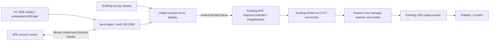

# Capture an existing Android display through a shell helper

Date: 2026-10-23. Baseline: `3367d35`, branch `android-virtual-desktop`.
Status: implementation plan; the helper, Surface IPC, and existing-display
capture described here have not passed runtime acceptance.

This is the next implementation sequence for the existing-display part of
[the Android driver plan](android-driver-plan.md). It replaces that plan's
speculative file layout for this work. Use the actual Java/Rust/shared C code
already in the repository. Do not introduce another pixel/USB implementation.

## 1. Result and scope

The user selects an existing scrcpy display, selects an EDID-supported adapter
mode, and starts screencasting. scrcpy continues owning and displaying its
original desktop. Stopping our screencast releases only our capture resources.
The first acceptance run starts our helper from PC ADB. A subsequent milestone
starts the identical helper using the APK's embedded wireless ADB client.

The previous live inspection found display 116, named scrcpy, 2560×1080 at
60 Hz, owned by `com.android.shell`, UID 2000. Treat those as observations,
not constants. Refresh and validate the display immediately before each start.
Do not resize, replace the Surface of, release, or recreate scrcpy's display.

Existing-display capture belongs to the desktop APK, API 30+. The API 24+
Mirror APK keeps its current consented phone/app capture and does not package
the helper or Rust bridge. Independent desktop creation/app launch/input are
later consumers of the helper and are not prerequisites for this milestone.

## 2. Architecture and responsibility boundaries

| Component | Responsibility |
|---|---|
| Helper | Privileged display enumeration, mirror creation, source-change monitoring and release of its own mirror |
| APK | USB permission, EDID/modeset choice, ImageReader/native capture, submitted batches, session state and user interface |
| Binder | Small requests/results, callbacks, Surface handles and death notifications |
| ADB | Authentication, helper transfer/start and bootstrap-stream lifetime |
| Android compositor | Producing the selected display's pixels into the supplied Surface |

ADB/Binder never carry image arrays or encoded video. Keep the existing direct
RGBX-to-UYVY conversion, scanner, batch planner, replay, drawing overlays and USB
acknowledgement rules. No Linux source changes are expected for this feature.
No vendor Android or scrcpy source is imported. References guide independently
written compatibility wrappers and tests.

## 3. Resolve the risky interfaces first: P0 prototype

Build a small end-to-end vertical slice before refactoring the session UI.

1. Add `android/ipc` and `android/helper`, with packages
   `io.github.ms912x.ipc` and `io.github.ms912x.helper`. Share generated AIDL
   types between helper and app. Use the installed SDK/AGP/JDK; compile SDK 36,
   helper minimum API 30. Generate a DEX-containing helper JAR using D8 and a
   reproducible Gradle task, then generate the desktop APK asset and SHA-256.
   Mirror builds omit these tasks/assets/components.
2. Add an APK bootstrap ContentProvider and a helper-side compatibility wrapper
   for ActivityManager/IContentProvider access. Prototype that actual Binder
   route on the API 37 phone and API 30 emulator; do not assume a fabricated
   ContentResolver context will work. No pixel work is allowed on provider or
   Binder threads.
3. Use the bootstrap authentication, protocol/build identity and reciprocal
   Binder death checks from section 4 of the main plan. The helper must really
   run as UID 2000, not root or the APK UID. The provider accepts only UID 2000;
   helper methods accept only the enrolled app UID. Bind every request and
   callback to the current session and geometry generation.
4. For PC testing, Debug explicitly opens one pending enrollment. A debug-only
   provider operation lets the UID-2000 helper claim that pending enrollment
   and obtain its one-use bootstrap challenge directly through Binder. Check
   the installed app is debuggable, consume the challenge once, and disallow
   claims without a pending attempt. Do not print a challenge with `adb content`
   or expose an unauthenticated debug broadcast. Release bootstrap uses the
   APK-generated token sent over the authenticated ADB stream's stdin, as in
   the main plan; it does not expose the development enrollment operation.
5. In the visible development Activity, reuse `CaptureController` to create a
   small output-sized ImageReader. Pass its Surface to the helper. The helper
   creates a separate mirror targeting the selected source ID. Confirm actual
   accepted frames, changing third-party pixels and continued source operation.
6. Release the helper's mirror, acknowledge release, then close the ImageReader.
   Repeat start/stop and helper death. Verify there are no orphan mirror displays
   and the original scrcpy display still exists.

P0 passes only after both the cross-process Surface and real source pixels work.
A Binder connection, screenshot command, APK-owned test scene or empty frames
cannot satisfy this gate. If access is denied, record the exact API, real UID,
Android build and exception; resolve that interface before broad integration.

## 4. Display backend and geometry: P1

Create `helper/DisplayCaptureBackend` and put all hidden API reflection in
`helper/FrameworkDisplayCompat`. The app never calls these privileged APIs.

- Prefer the hidden static DisplayManager mirror factory when present:
  `createVirtualDisplay(String, int outputWidth, int outputHeight,
  int sourceDisplayId, Surface)`.
- Probe the method at runtime and unwrap reflection failures. Its presence
  does not establish permission or successful capture. An explicit permission
  denial is a capability failure, not permission to try arbitrary flag variants.
- The Android 11 AOSP DisplayManager source inspected for this plan does not
  contain this overload. Implement a bounded legacy SurfaceControl backend
  using a mirror sink, the selected source's layer stack, projection rectangles
  and a transaction. Keep API-specific signatures inside the compatibility
  wrapper. Use non-secure capture and do not bypass protected content.
- Test the legacy path on API 30; do not claim Android 11 support from the
  recent-phone result. If both known backends fail, return a specific unsupported
  result and keep the source disabled. Never substitute display 0 silently.
- A backend owns only its created mirror/token and local Surface reference.
  It must release partial construction on every failure, close idempotently,
  and unregister its source listener on teardown.

The reader/native pipeline always uses the selected adapter output dimensions.
Do not feed a 2560×1080 frame into a 1920×1080 native session and expect cropping
or scaling to occur in `offerRgba()`.

Use aspect-preserving fit with black letterboxing and no source display resize.
For 2560×1080 into 1920×1080 the content rectangle is 1920×810, centered at
`(0, 135)`. Preserve RGB color and correct orientation before RGBX conversion.
Rotation changes the source-to-output transform, not scrcpy's screen rotation.
The existing helper UI must not advertise rotations that this backend has not
implemented and tested; mirror geometry controls have their own capability.

First test compositor fitting directly, including the bars and all four edges.
If a backend cannot provide the required transform, add an isolated helper-side
EGL/SurfaceTexture renderer between its source mirror and the app's Surface.
It clears the output black and performs one fit/rotation draw with bounded
latest-frame buffering. Do not add a second CPU conversion/scanner or import
scrcpy's GL code. Report the selected backend/transform in Debug.

Refresh is also separate: the adapter runs at the EDID-selected mode; the source
retains its existing Android-managed refresh. Do not add an application frame cap.
Source resolution/rotation changes recompute the transform while keeping output
geometry fixed. Source removal stops the session and never selects a replacement
with a reused display ID without a new user selection.

## 5. IPC and lifecycle contracts: P2

Implement the existing-display subset of the main plan's AIDL, rather than the
unrelated launch/input/desktop-creation operations. Use typed parcelables:

| Type | Required fields |
|---|---|
| ProtocolInfo | protocol version, build digest, real helper UID, API level |
| DisplaySourceInfo | ID, unique/source identity where available, name, dimensions, rotation, source refresh, capture capability and reason |
| CaptureSpec | session ID, request ID, generation, expected source identity, output width/height, mode ID, fit policy, output rotation |
| CaptureResult | matching IDs/generation, source identity, helper mirror ID, backend, effective content rectangle, result code and bounded detail |

Methods: `getProtocolInfo`, `listDisplaySources`,
`attachExistingDisplayCapture(spec, surface, callback)`, `releaseCapture`,
`heartbeat`, and `stopSession`. Framework operations complete asynchronously
on one helper control thread. Validate before enqueueing; bound the queue and
return a busy result rather than retaining unlimited Surface references.

Separate `mirrorCreated` from `firstImageAccepted`. Start USB only after the
matching current-generation capture accepts an image. A startup timeout tears
down the partial capture and tells the user that the selected source produced
no frame. Binder/ADB liveness, startup timeouts and cancellation are independent
of image arrival; a static desktop is not a failed helper.

Use the main plan's heartbeat/watchdog: 2-second heartbeat, 10-second expiry,
monotonic time, and no dependency on the display control thread. EOF of the
bootstrap ADB stream, either Binder death, USB detach or source removal cancels
the session. Old callbacks cannot revive a stopped or replacement session.

Normal stop, in order:

1. Mark the session stopping, invalidate its generation and reject new starts.
2. Stop USB submissions and asynchronously drain the active batch/worker through
   its existing cancellation/completion rules. Add an explicit drained callback
   to `UsbOutputController`; never join its worker on the UI thread, since worker
   completion currently posts back to that thread.
3. Ask the helper to detach/release its mirror and await acknowledgement. If the
   helper has died, reconcile resources using Binder death. A release timeout
   enters a failure/cleanup state and closes the bootstrap stream; do not pretend
   the helper acknowledged release or start another session over uncertain state.
4. Close the APK reader/native capture after its producer and USB users have
   stopped. Close this session's helper stream/process and foreground owner.

Cancellation during startup uses the same path. USB drain and helper release
may be initiated together, but both must finish before capture destruction.
Never release scrcpy's source display, kill scrcpy or force-stop its apps.

## 6. Session ownership and interface: P3

Add `SessionCoordinator` plus a connected-device foreground session service.
The service owns the USB output/session lifetime and helper-capture source;
MainActivity observes immutable state and issues user actions. Introduce a
small `CaptureSource` start/stop contract so the coordinator can use the existing
phone/app projection and owned-display sources as well as the helper source.
Keep pixel ingestion and batch encoding inside `CaptureController`.

Move USB transport off its hard Activity dependency: use application Context,
a main-thread Handler, and a UI adapter-choice callback. Reuse `UsbHost` and the
existing permission/probe/stream state machine. One authority owns the selected
adapter; an Activity startup/attach EDID probe must not open another controller
against the active session. Preserve automatic probes and manual mode retention.

Retain `ProjectionCaptureService` for actual MediaProjection consent/foreground
ownership. The shell-capture source must not manufacture a MediaProjection
token or start a mediaProjection service without consent. For USB session
ownership declare connectedDevice and its API-34+ permission, obtain USB
permission before starting that foreground service, and verify the requirements
on the phone. Capture-only development previews remain visible-Activity tests
unless a separately valid foreground-service path is implemented.

Replace `ScreenSource.canStart()`'s ID-only decision with evaluated capability
from source type, helper connection/backend, source identity and current session.
Refresh both display inventory and helper capabilities on dropdown opening.
Keep all current rotation/refresh, appearance, monitor-name and single-button UI.

States: `IDLE → PREPARING_HELPER → STARTING_CAPTURE → WAITING_FIRST_FRAME →
STREAMING → STOPPING → IDLE`, with failure routed through cleanup. Display
`ADB setup required`, `Helper disconnected` or a concrete backend failure instead
of the generic build limitation. Ready/Start is enabled only for an eligible
source and validated output mode. Preview may run without USB only in Debug.

Back opens Home while casting. Rotation, Activity recreation, UI rebinding and
drawer navigation do not destroy the service-owned session. Notification Stop
and the app's single Stop button execute the same idempotent teardown. Test
this behavior after the ownership change, including active phone mirroring.

## 7. Embedded ADB bootstrap: P4

Extend the pinned DroidMux bridge; do not add another ADB implementation.
The current JNI methods pair/connect and execute `id`, then return text.
They do not retain the live helper stream needed here.

Add a Rust session owner with opaque handle, explicit connect/bootstrap/close,
an async runtime that outlives each JNI call, and bounded event delivery to Java.
Reuse current credential storage and endpoint validation. Provide fixed helper
operations, not an arbitrary shell command UI. Pairing UI remains separate from
capture and USB permission.

Verify UID 2000, transfer the generated helper through the provider's sync API,
verify the build digest in its shell-owned path, and start the helper with a
fixed, correctly quoted `CLASSPATH=... app_process / ...HelperMain` command.
Send the single-use bootstrap envelope through stdin, consume bounded stdout/
stderr continuously, and retain the shell stream until stop. Tokens and pairing
codes never enter command arguments, logs or saved artifacts. Connect must work
again with stored credentials; helper startup cannot require pairing every time.

Verify actual same-phone pairing/TLS, transfer and startup on the physical phone.
Do not enable adbd TCP globally or assume port 5555. A PC-launched helper proves
P0–P3 only; P4 requires starting from the APK without PC assistance. Loss of
Wireless debugging stops the helper/session explicitly in this first version.

## 8. Files and implementation checkpoints

| Checkpoint | Files/responsibility | Required result before moving on |
|---|---|---|
| P0 | `android/ipc`, `android/helper`, Gradle generated assets, `HelperBootstrapProvider`, PC launcher under `tools/android` | Authenticated Binder/Surface prototype with real changing source pixels |
| P1 | Helper display compatibility, source listener and fit/rotation transform | Selected secondary capture on phone; API 30 backend; correct 2560×1080 fit |
| P2 | Typed IPC, helper client/controller and death/watchdog/release fixtures | Cancellation, late results and crashes clean up only our mirror |
| P3 | Session service/coordinator, small USB ownership extraction, MainActivity/source capabilities | User starts/stops selected scrcpy source; Home/recreation keeps capture; HDMI passes |
| P4 | `android/adb-rs`, `NativeAdbBridge`, Java bootstrap controller | Same-phone startup and reconnect without PC; original helper and pixel paths reused |

Keep checkpoints reviewable. P0 may expose controls only in Debug. Do not enable
the normal existing-display Start button until P1–P3 have passed. Commit code
checkpoints after their focused checks and functional hardware gate pass, as
requested for this Android work; record PC-assisted and standalone gates separately.

## 9. Tests and acceptance evidence

- Build both APK variants and lint. A clean desktop build generates its own
  helper/IPC asset and matching digest. Mirror contains neither helper nor Rust.
- Add fixtures at framework boundaries: wrong UID/token/build/session, duplicate
  enrollment, malformed/closed Surface, missing display, reused ID, permission
  denial, absent API signature, partial mirror construction and release failure.
- Exercise cancelling every startup state, simultaneous Stop/detach/death,
  blocked display operation/watchdog, late callbacks, startup timeout, source
  geometry changes, helper restart, UI recreation and repeated start/stop.
  Assert exact owned-resource release and no stale batch commit.
- Check aspect/rotation math with labelled corners and a circle: equal-aspect,
  ultrawide, portrait and all supported rotations. Inspect pixels/black bars,
  not only successful method calls. No CPU frame scaling is added to shared C.
- Run existing desktop 14-group and Mirror 6-group regression suites, extending
  the runner/count assertions when adding groups. Retest API 24 Mirror and API
  30 desktop for the Java/session changes; recent phone alone is insufficient.
- On the phone, enumerate and record the current scrcpy source identity. Render
  a separate test APK with changing content on a test source (or record the
  current source without moving the user's existing tasks). Prove the phone,
  source and HDMI contents are distinct as expected. Keep the source alive and
  independently updating after Stop; never destroy it for test cleanup.
- Record UltraSemi HDMI using its persistent by-id path, excluding the KVM
  webcam. Verify matching-mode content first, then 2560×1080 → EDID-supported
  output fit. Use a checker for the scaled scene/corner/bar regions; the current
  unscaled pattern checker alone cannot prove ultrawide fitting. Record actual
  checked samples/errors/exclusions; card samples are not display FPS.
- Record APK/helper digests, Android build/API, backend, source/mirror IDs,
  EDID-selected mode, ImageReader accepted/rejected counts, USB completion and
  before/after display inventories under `android/app/build/reports/`.
  Update `docs/android-validation.md` with measured results and remaining gates.

## References

- [Main implementation plan and IPC authentication](android-driver-plan.md).
- [Existing shell-assisted owned-screen tests](android-virtual-display-test.md).
- [MediaProjectionConfig public capture selection](https://developer.android.com/reference/android/media/projection/MediaProjectionConfig).
- [AOSP Android 16 DisplayManager, including hidden mirror factory](https://raw.githubusercontent.com/aosp-mirror/platform_frameworks_base/android16-release/core/java/android/hardware/display/DisplayManager.java).
- [AOSP Android 11 DisplayManager](https://raw.githubusercontent.com/aosp-mirror/platform_frameworks_base/android11-release/core/java/android/hardware/display/DisplayManager.java).
- [Foreground service type requirements](https://developer.android.com/develop/background-work/services/fgs/service-types).
- scrcpy reference: `/tmp/scrcpy-master.zip`, `ScreenCapture.java`,
  `wrappers/DisplayManager.java`, `wrappers/SurfaceControl.java`; inspected as
  reference, not copied or used as an implementation dependency.
