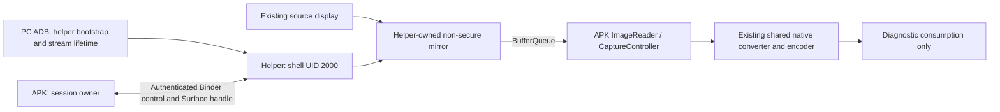

# PC-assisted existing-display capture

**Historical P0 checkpoint.** The instructions and restrictions below describe
that development build. Later phases added [normal USB output](android-shell-capture-p3.md),
[embedded ADB](android-shell-capture-p4.md), and [independent screens](android-created-screen.md).
Use the [Android README](../android/README.md) for the current workflow.

At P0, the desktop APK captured an existing Android display using a separate
`app_process` helper started by PC ADB as shell UID 2000. This P0 implementation
proves the privileged capture and cross-process Surface boundary. It is exposed
only through Debug and leaves the original display and its tasks under their
existing owner's control.

That checkpoint was a capture-only preview. It did not start USB output, replace the normal
MediaProjection path, or provide standalone on-device helper startup. The Activity
must remain visible; leaving it stops this development session. The normal
screencast button remained disabled for existing secondary displays.

## Build and run

Build the desktop APK using the installed SDK:

```sh
ANDROID_HOME=/mnt/data/LINUX/android-sdk \
ANDROID_SDK_ROOT=/mnt/data/LINUX/android-sdk \
  android/gradlew -p android :app:assembleDebug :app:assembleDebugAndroidTest :app:lintDebug
adb -s DEVICE install -r android/app/build/outputs/apk/debug/app-debug.apk
```

The build runs `:helper:assembleDexJar`, generates a reproducible DEX-containing
`android/helper/build/outputs/helper.jar`, and packages it with `helper.sha256`.
The helper and app compile the same AIDL/Parcelable sources from `android/ipc`.
Mirror builds (`-PmirrorOnly=true`) do not configure these modules or package
their classes, provider or assets.

1. Keep the desired source display running. Select it in **Source screen**.
   Select an output resolution. Without an adapter mode, the preview uses 640×480.
2. Open **Settings and navigation → Debug → Prepare ADB helper**. This opens
   one enrollment attempt for 60 seconds.
3. On the PC, run the fixed launcher and leave its ADB stream open:

   ```sh
   python3 tools/android/launch_helper.py --serial DEVICE
   ```

4. After **Helper connected**, select **Preview selected display with ADB helper**.
   The status becomes active only after mirror creation and an accepted ImageReader
   image. Debug reports accepted images, encoded batches and changing payload
   signatures. These counters do not measure USB throughput or monitor FPS.
5. **Stop helper preview** waits for mirror-release acknowledgement before
   destroying the reader. It permits another preview with the same helper.
   Leaving the Activity or closing the launcher's stream ends the helper session.

The APK and launcher must use the same build artifact. The launcher verifies both
the packaged and transferred helper SHA-256 and rejects ADB shells that do not run
as UID 2000, including root. It never prints the bootstrap challenge or places it
on the command line.

## Process and buffer ownership



`HelperCaptureController` owns the app-side preview and serial diagnostic worker.
It reuses `CaptureController`, `FrameSubmission` and the Linux-derived native
pipeline. Diagnostic consumption acknowledges its own encoded batches without
USB submission; normal output's transfer/acknowledgement rules are unchanged.
Binder carries typed requests, callbacks and a Surface handle. Neither Binder
nor the ADB stream carries pixel arrays or an encoded video stream.

All privileged calls stay in `android/helper`. `FrameworkDisplayCompat` uses
the hidden DisplayManager mirror factory on the recent phone. When that method
is absent, the bounded API 30 compatibility path uses SurfaceControl and the
selected source layer stack. An explicit failure of a present method is returned
to the caller. Both paths create and release only their own mirror and local
Surface reference; neither resizes or destroys the source.

The helper does not request secure mirroring or bypass protected content.
Capturing ordinary third-party fixture pixels does not establish DRM-content
compatibility or expose a Cast/MediaRouter receiver.

## Enrollment and lifetime

The exported desktop bootstrap provider accepts only actual calling UID 2000.
Only a debuggable APK with an explicit pending enrollment permits `claimDebug`.
A 256-bit challenge is single-use and expires after 60 seconds. Enrollment checks
protocol version, helper digest and session identity before returning reciprocal
Binder handles. Helper Binder methods accept only the enrolled APK UID; app
callbacks accept only shell UID 2000.

Requests/results include session, request and geometry generation identifiers.
The helper has a serial control thread and a bounded attach queue. The app sends
heartbeats every two seconds. An independent helper watchdog stops the process
after ten seconds without a heartbeat; source queries cannot block that timer.
App Binder death, helper Binder death and ADB stream EOF also end the session.
The reader is closed after mirror acknowledgement or confirmed helper death.
Source removal or identity replacement stops the preview and requires reselection.
Size/orientation changes now reconfigure capture while keeping output dimensions
fixed; see [P1 geometry support](android-shell-capture-p1.md).

This is the development bootstrap, not the release token-over-ADB bootstrap.
Protocol 3 uses asynchronous inventory/control with bounded work, cancelled
generations and confirmed-death cleanup; see [P2 control and lifetime](android-shell-capture-p2.md).
Service-owned USB sessions and embedded bootstrap were added in
[P3](android-shell-capture-p3.md) and [P4](android-shell-capture-p4.md).

## Runtime acceptance

Use a changing source owned by another UID, such as the test APK's
`ExternalDisplayFixtureActivity` launched onto a separately owned scrcpy display.
Installed scrcpy is used only to establish the test source; its code and native
libraries are not dependencies of our helper or APK.

Install the test APK before launching its fixture (reinstallation stops that
fixture). With the separate source display already running:

```sh
adb -s DEVICE install -r android/app/build/outputs/apk/androidTest/debug/app-debug-androidTest.apk
adb -s DEVICE shell am start --display DISPLAY_ID -W -f 0x18000000 \
  -n io.github.taglia_ti.ms912x_ng.desktop.test/io.github.taglia_ti.ms912x_ng.desktop.ExternalDisplayFixtureActivity
```

Then run the acceptance script:

```sh
python3 tools/android/test_helper_capture.py \
  --serial DEVICE --source-id DISPLAY_ID \
  --report android/app/build/reports/helper-DEVICE
```

The script starts only our APK on display 0. It performs two start/stop runs,
requires accepted images and changing encoded payloads, checks release
acknowledgement and source identity, and waits for our mirror to disappear from
DisplayManager and SurfaceFlinger. It then kills only `ms912x-helper` while
capture is active and checks app cleanup and source preservation. Reports include
APK/helper hashes, build fingerprint, capture counters and display inventories.
It never tears down the source display.

Runtime acceptance passes on API 30's SurfaceControl backend and the API 37
phone's DisplayManager backend. See [the measured evidence](android-validation.md).
This establishes capture/encoding and cleanup, not USB/HDMI presentation.

## Later implementation

The later [geometry](android-shell-capture-p1.md),
[control/lifetime](android-shell-capture-p2.md),
[service-owned output](android-shell-capture-p3.md), and
[embedded bootstrap](android-shell-capture-p4.md) documents record their own
results and limits.

The architecture follows the separate shell-helper approach documented by
[scrcpy](https://github.com/Genymobile/scrcpy/blob/master/doc/develop.md), using
independently written Android compatibility wrappers and the existing MS912x
pixel pipeline.
