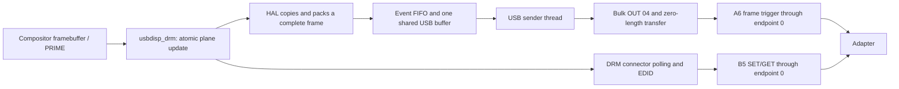

# MS9132 Linux source: untrusted implementation hints

Analysis dated 2026-10-19 of `drivers/ms9132-drm-linux-master/`, compared
with the current driver in this repository and the previously inspected
[Android](android-driver-analysis.md), [macOS](macos-vs-android-analysis.md),
and [Windows](windows-vs-android-macos-analysis.md) packages.

**Evidence policy:** treat this entire source tree as untrusted hints only.
Descriptions below record what its code says or attempts, not established
adapter support, register semantics, hardware limits, or correct operation.
Its attribution does not confer trust. Claims supported only here remain
tentative until independently corroborated by Android/Windows/macOS or hardware
evidence; matching behavior in those drivers retains its independent support.

The supplied source was inspected without modification. An untouched copy
was compiled in a temporary directory to check current kernel compatibility.
Neither module was installed or loaded, and no USB controls were sent.

The [VIDEO_OUT timing inventory](video-out-modes.md) compares its 16-entry
ordinary adapter whitelist with all desktop/mobile packages, and separates
the generic DRM/CEA table from adapter-specific output-mode support.

## Main conclusions

- This is recognizably the same protocol family: HID feature reports with
  `B5`, `B6`, and `A6`, the same transfer-mode numbers, and bulk endpoint 4.
- Its **active path is FRAME = 0**, sending a complete uncompressed frame,
  a zero-length bulk transfer, and then `A6 00 INDEX 64 00 00 00 00`.
  It does not implement the FF00/FF80/FFC0 rectangle stream used by the
  inspected desktop drivers or our current module.
- The public DRM plane exposes **XRGB8888 only**. Normal USB payloads are
  24-bit pixel data, with device memory configured as YUV422 (`VIDEO_IN = 21`).
  HAL support for additional formats must not be confused with formats
  actually exposed to applications.
- Only **`345f:9132`** is matched. The HAL recognizes MS9120/MS912A/MS912C
  signatures, but that does not make the supplied package support our
  attached `534d:6021` adapter. Additional HAL ID checks also prevent merely
  adding a USB-table entry from being sufficient.
- No audio transport, ALSA card registration, or HDMI audio configuration
  was found. Matching only the vendor interface leaves a separate USB Audio
  function available to its own class driver, if the hardware exposes one.
- The source provides useful register and command names, but also contains
  correctness and lifetime defects. It is not an established replacement
  for this repository's damage-aware transfer implementation.

## Attribution, version, and evidence

The local README says these files were extracted from the vendor archive
`MS91xx_Linux_Drm_SourceCode_V3.0.1.3.zip`. Source headers identify
`Copyright (C) 2023 MacroSilicon Technology Co., Ltd.` and GPL version 2.
Those are local attribution/provenance statements; this analysis did not
independently authenticate the original archive or compare it with a fresh
vendor download.

`release note.txt` records:

| Date | Release | Stated change |
| --- | --- | --- |
| 2023-11-21 | 3.0.0.1 | Initial release |
| 2024-08-09 | 3.0.1.2 | Adds Linux 6.6.18 support |
| 2024-09-13 | 3.0.1.3 | Bug fix, without specifics |

Other identifiers differ: the USB module declares version `1.1.0`, while
the platform DRM descriptor declares version `1.0.0` and date `20230710`.
These should not be silently substituted for the archive release number.

There are 47 files in the supplied tree, including 7,596 lines across its
`drm/*.[ch]` and `usb_hal/*.[ch]` files. A size/SHA-256 inventory is saved in
`drivers/ms9132-analysis/source-inventory.json`. A digest of sorted
`relative_path + NUL + file_sha256 + newline` records is saved in
`source-tree-sha256.txt`:

```text
8eed03b2a2583770d376e977e4da72175dd954a54980cee8eeb4dd80f088b74a
```

Source anchors below use paths relative to `drivers/ms9132-drm-linux-master/`.
The supplied source and generated logs remain under the existing `drivers/`
ignore; this report and its README link are the intended tracked additions.

## Architecture and device matching

The build produces two kernel modules:

| Module | Role |
| --- | --- |
| `usbdisp_drm.ko` | Platform devices, GEM buffers, PRIME sharing, atomic DRM planes/CRTCs/connectors, EDID, polling, and synthetic vblank |
| `usbdisp_usb.ko` | USB binding, HAL, pixel packing, event queue, and a USB sender kernel thread |



Defaults are one DRM platform device with three pipelines. Constants permit
up to three platform devices with three pipelines each; that is a software
capacity, not verified simultaneous hardware operation. The current module
instead creates its DRM device around an attached USB adapter.

`drm/msdisp_usb_drv.c:272` matches only VID/PID `345f:9132` and interface
class/subclass/protocol `FF/00/00`. It does not claim standard Audio or HID
interfaces. The module filename is `usbdisp_usb.ko`, but the registered USB
driver name is `msdisp_usb`.

There are further VID/PID checks in `drm/ms9132_hal.c:138` and
`usb_hal/hal_adaptor.c:30`, both using the sole `ms9132_id` definition.
Changing only the USB device table would still fail HAL selection for
another ID.

The package's `usbdisp_monitor.sh` and systemd service are Xorg integration:
the script polls Xorg, associates RandR providers, and enables connected
outputs every five seconds. It also handles Xauthority files. It contains
no USB protocol or audio implementation and was not executed. The kernel
driver's existence does not by itself establish compatibility with a
particular Wayland compositor.

Sources: `drm/Kbuild`, `drm/msdisp_plat_drv.c:28`,
`drm/msdisp_drm_drv.c:41`, `drm/msdisp_drm_drv.h:56`,
`drm/msdisp_plat_drv.h:31`, and `drm/usbdisp_monitor.sh`.

## USB controls and new protocol names

`usb_hal/ms9132.c:234` constructs feature-report transfers:

| Operation | bmRequestType | bRequest | wValue | wIndex | Payload length |
| --- | --- | --- | --- | --- | --- |
| SET_REPORT | `21` | `09` | `0300` | 0 | 8 bytes |
| GET_REPORT | `A1` | `01` | `0300` | 0 | 8 bytes |

It uses the kernel's `USB_CTRL_SET_TIMEOUT`/`USB_CTRL_GET_TIMEOUT` constants.
The helper converts negative transfer results to positive `1`, otherwise
zero; it does not verify that a successful transfer returned all eight bytes.

Register reads send `B5 AH AL 00 00 00 00 00`, then perform GET_REPORT.
**Up to four consecutive bytes are copied from response offsets 3–6**.
`ms9132_read_xdata()` advances the address in chunks of at most four.
Register writes send `B6 AH AL VALUE 00 00 00 00`.

The header `usb_hal/ms9132_hid.h` supplies explicit opcode names:

| Opcodes | Header meaning | Implementation status here |
| --- | --- | --- |
| `B5`, `B6` | Read XDATA; write one byte | Implemented and used |
| `12`, `13`, `14`, `15` | Write two, three, four, five bytes | Definitions only |
| `B7`, `B8` | Read/write USB3 registers | Definitions only |
| `B9`, `BA` | Read/write HDMI PHY registers | Definitions only |
| `C5`, `C6` | Read/write SFR | Definitions only |
| `D5`, `D6` | Read/write SDRAM | Definitions only |
| `E5`, `E6` | Read/write EEPROM | Definitions only |
| `F5`, `F6`, `34`, `F7`, `F8` | Flash read/write operations | Definitions only |
| `FB`, `FE` | Flash erase operations | Definitions only |

This suggests a candidate meaning for Android's payload
`12 F2 02 00 INDEX 00 00 00`: **write two bytes**. It is not trusted protocol
documentation. A possible interpretation is a two-byte write starting at
F202, consistent with the desktop register names TRANSFER/SWITCH. This
Linux source only defines the opcode, so exact address-increment behavior
for that command is not independently demonstrated by an implementation here.

The active A6 helpers provide:

| Subcommand | Meaning | Payload |
| --- | --- | --- |
| `00` | Trigger frame | `A6 00 INDEX DELAY 00 00 00 00` |
| `01` | Input dimensions/format | `A6 01 WH WL HH HL COLOR BYTE_SEL` |
| `02` | Output VIC/format/dimensions | `A6 02 VIC COLOR WH WL HH HL` |
| `03` | Transfer mode | `A6 03 MODE PARAM0 PARAM1 PARAM2 PARAM3 00` |
| `04` | Transfer enable | `A6 04 ENABLE 00 00 00 00 00` |
| `05` | Video enable | `A6 05 ENABLE 00 00 00 00 00` |
| `07` | Power | `A6 07 ENABLE 02 00 00 00 00` |

The power helper keeps byte 3 equal to `02`, including on power-off, as the
Mac helper does. The Android/Windows power helpers and our current Linux
power-off path use zero there.

Transfer-mode numbers are FRAME 0, FIX_BLOCK_MN 1, FIX_BLOCK_WH 2,
MANUAL_BLOCK 3, BYPASS_FRAME 4, and BYPASS_MANUAL_BLOCK 5. These source names
are hints consistent with the independently inspected Android/Windows/macOS
commands for transfer-mode selection and transfer enable. The MS9132 source
alone does not confirm this repository's `MS912X_CMD_UNKNOWN1`/`UNKNOWN2`
meanings. No renaming or
protocol changes were applied to our module during this analysis.

Sources: `usb_hal/ms9132.c:285`, `:319`, `:416`, `:448`, `:461`, `:578`;
`usb_hal/ms9132_hid.h:19`.

## Actual frame sequence and pixel formats

HAL initialization sets `trans_mode = 0` and memory format YUV422.
The DRM plane exposes only `DRM_FORMAT_XRGB8888`; framebuffer creation also
rejects formats whose first-plane pixel size is not 32 bits. For the normal
path, the CPU drops the fourth byte from each pixel, respecting source pitch.
On a little-endian host, XRGB8888 bytes become **B, G, R** on the wire, called
RGB888 by the device's format enum.

Consequently:

- USB input format nibble is 1, RGB888.
- Device memory format nibble is 2, YUV422.
- VIDEO_IN receives **`COLOR = 0x21`**, rather than our module's `0x22`.
- VIDEO_OUT receives color value 1 for this normal path.

The HAL has RGB565, RGB/BGR24, other RGB32, NV12, and planar YUV420 conversion
paths, but these are not all usable through the supplied public DRM plane.
Its `yuv422p_pix` structure is actually packed `U0 Y0 V0 Y1` (UYVY), despite
the potentially misleading suffix. Those YUV helpers do not establish an
active host RGB-to-YUV conversion path in the normal DRM configuration.

The enable event does the following:

1. Stop transfer and video output; mute the screen through chip-specific registers.
2. Wait 50 ms, request power-on, and wait another 50 ms.
3. Select FRAME 0, set input/output dimensions and formats, and start transfer.
4. Wait 50 ms and keep video/screen output disabled until the first frame send.
5. Read the current frame index from `0xD003`, interpreting zero as buffer 0
   and any nonzero value as buffer 1.

Each update then follows `usb_hal_thread.c:65`:

```text
bulk OUT 04: complete raw pixel buffer
bulk OUT 04: zero bytes
frame_index = frame_index ? 0 : 1
SET_REPORT: A6 00 frame_index 64 00 00 00 00
```

`64` is hexadecimal 100, passed to a parameter named `delay`. The source
does not establish its units or firmware semantics; it should not be
described as a measured 100 ms wait or as a frame-rate limit.

The data transfer uses one URB, with a 2000 ms timeout. The following
zero-length transfer also uses 2000 ms. On the first successful data send,
the worker enables video and clears the chip-specific screen mute.

There are **no rectangle headers, FF80/FFC0 terminators, or FF-to-FE pixel
substitutions in this path**. Defined MANUAL_BLOCK support in the mode helper
does not mean that a block packer or active block sender exists here.

At 1920×1080, the normal payload is 6,220,800 bytes per frame, compared with
4,147,200 bytes for our full-frame UYVY pixels. The former is 50% larger,
before considering our damage reduction. These are calculated sizes, not
measured frame rates or USB throughput.

Sources: `usb_hal/usb_hal_interface.c:66`, `:224`, `:301`, `:560`, `:844`;
`drm/msdisp_drm_modeset.c:422`; `drm/msdisp_drm_fb.c:179`;
`usb_hal/ms9132.c:645`; `usb_hal/usb_hal_thread.c:65`.

## Damage handling, buffering, and presentation

Although the plane advertises DRM damage clips, the active
`msdisp_drm_handle_damage()` ignores rectangle coordinates and submits the
whole framebuffer (`pitch × height`). The USB path packs the whole active
image. There is no dirty-tile comparison or region coalescing.

One 6 MiB USB buffer is allocated per adapter, first with
`usb_alloc_coherent`, then with a vmalloc/scatterlist fallback. A mutex
protects buffer copying against transfer. UPDATE events contain a length,
not their own pixel snapshot; several queued descriptors can therefore
refer to the same latest buffer contents. The DRM callback uses trylock and
can drop an update with `-EBUSY` while a send holds the buffer mutex.

After the first frame, the worker also **replays the buffer after roughly
two seconds without an update**: 100 waits of 20 ms. That is an explicit
idle resend policy, not evidence that the hardware requires one. Our current
driver intentionally avoids idle replay traffic.

DRM vblank and pending page-flip events are generated by a **fixed 20 ms
timer**, equivalent to 50 timer ticks per second, independent of the selected
60 Hz output timing and USB transfer completion. It does not establish
50/60 fresh displayed frames per second or hardware-synchronized page flips.

Sources: `drm/msdisp_drm_modeset.c:265`, `:386`, `:487`;
`usb_hal/usb_hal_interface.c:583`; `usb_hal/usb_hal_event.h:26`;
`usb_hal/usb_hal_thread.c:210`; `usb_hal/usb_hal_thread.h:4`;
`drm/msdisp_drm_drv.c:39`, `:138`.

## Chip identification, display mute, EDID, and modes

The chip detector first reads three bytes at FF00. If bytes 1/2 are
`13 0A`, it assigns the MS9132 enum. Otherwise it reads F000; bytes 1/2
`16 0A` select the MS912x family, with first byte `B7` identifying MS912C,
`A7` identifying MS912A, and other values selecting MS9120.

Registers `0030`, `0031`, and `0032` are named SDRAM type, output port,
and HPD in this source. The same SDRAM and port enum values found in the older
binaries are present here. Its output-enable branches suggest the following
**candidate family-specific registers**, not a trusted hardware register map:

| Chip/output | Register and bit | Enable behavior |
| --- | --- | --- |
| MS9132 HDMI | `FB07`, bit 1 | Clear bit |
| MS9132 other ports | `F037`, bit 0 | Set bit |
| MS912x HDMI | `F507`, bit 1 | Clear bit |
| MS912x VGA | `F004`, bit 7 | Set bit |
| MS912x YPbPr | `F030`, bit 0 | Set bit |
| MS912x digital | `F005`, bit 4 | Set bit |
| MS912x remaining ports | `F004`, bit 1 | Set bit |

F004 bit 7 is specifically the VGA branch in this source; that assignment
remains a hint and should not be generalized to every HDMI variant. The FB07
symbol names
the bit **VIDEO_MUTE**, providing no evidence of an audio mute control.

EDID blocks are read from `C000 + block × 128`, in four-byte B5 transactions.
A 128-byte block takes 32 SET/GET pairs. This differs from the byte-at-a-time
Windows helper and our driver's current 64-byte-report/60-byte-payload fast
path with one-byte fallback. Four-byte B5 reads are a possible fallback
optimization only after validating the target firmware's response.

Synthetic EDID is selected for analog outputs, the 2 MiB SDRAM type, and
the no-SDRAM type. The no-SDRAM branch selects between two synthetic VGA
blocks using `udev->speed == USB_SPEED_SUPER`. Ordinary digital/HDMI/VGA
paths with other SDRAM types read the hardware EDID. DRM's
`drm_do_get_edid()` performs the connector read and validation. HPD treats
any nonzero register result as connected, and EDID is fetched on the
disconnected-to-connected transition.

DRM dimensions are limited to 640×480 through 1920×1080. The built-in VIC
lookup has 16 VESA modes, all at 60 Hz, with 1920×1080 mapped to VIC 129
and 1280×720 to 79. A separate CVBS/S-Video helper advertises 720×480 CEA VIC 2;
that does not bypass the enable-time validator. The validator uses
`width × height × 4` bytes of SDRAM; its comment attributes this to two frames
at two bytes per pixel. This is an untrusted implementation rule and proposed
device-memory model, not a confirmed hardware requirement. It is separate
from the three-byte USB payload size.

The `custom_mode` module parameter supplies `VIC_WIDTHxHEIGHT@RATE` records.
It registers numeric VIC mappings; no active flash custom-timing read or
pixel-clock/porch upload implementation was found. Flash opcodes in the
header alone do not provide such functionality.

Sources: `usb_hal/ms9132.c:360`, `:509`, `:631`, `:790`, `:806`;
`usb_hal/usb_hal_interface.c:120`; `drm/msdisp_drm_connector.c:149`;
`drm/msdisp_drm_modeset.c:518`; `drm/msdisp_usb_drv.c:65`.

## Audio

Neither module registers an ALSA device, sends isochronous audio packets,
or configures an HDMI audio engine. The only bulk endpoint selected is 4,
and the USB match restricts binding to the vendor interface.

This is consistent with a separate USB Audio function being handled by
`snd-usb-audio`, as already observed on the attached `534d:6021` device.
It does not demonstrate that every MS9132 product exposes that function or
that audible HDMI output has been tested on an MS9132 adapter. See the
[audio follow-up](windows-vs-android-macos-analysis.md) for the descriptor
and ALSA evidence from the attached adapter.

## Implementation defects and limits found during review

These are source-level findings, not reproduced hardware failures:

| Finding | Evidence and consequence |
| --- | --- |
| Old framebuffer selected for updates | `drm/msdisp_drm_modeset.c:335` uses `old_state->fb`, not the new plane framebuffer. On buffer flips this selects the previous image; an initial update with no old framebuffer returns early. |
| Sender thread is not joined before freeing its data | `usb_hal/usb_hal_interface.c:910` clears a run flag, sleeps 300 ms, and frees the buffer/device. Sends can wait 2000 ms per USB operation; no `kthread_stop()`/completion join ensures the worker has exited. This permits a lifetime race. |
| Custom-mode width is assigned during comparison | `usb_hal_interface.c:109` and `:168` use `width = requested_width` inside the condition. This mutates the table and can accept a width mismatch when height/rate match. |
| Custom-mode input exceeds a fixed array without a parser bound | `drm/msdisp_usb_drv.c:97` increments `custom_mode_cnt` into a 16-entry array without checking the limit. The later HAL limit does not protect this earlier parser. |
| Power-on failure check uses a stale return value | `ms9132.c:681` calls `ms9132_set_power_enable()` without assigning its return to `rtn`; the following check therefore does not test power-on success. |
| Failed frames can still advance the frame index | `usb_hal_thread.c:85–99` attempts the ZLP and trigger even when the data URB fails. It ignores trigger status and does not propagate ZLP failure; positive short control transfers and successful short data transfers are not rejected. |
| HAL state can become enabled after failed setup | `usb_hal_thread.c:114–129` logs an enable error but still sets `state = ENABLED`. |
| SET/GET register transactions lack a shared control lock | The HAL uses no mutex around B5 request/response pairs. DRM polling, the sender, and register sysfs accesses are separate callers; their control sequences can interleave. |
| FIFO writes are unchecked and use one shared pixel buffer | `usb_hal_interface.c:264`, `:283`, and `:606` ignore `kfifo_in()` results. Buffer updates are not per-event snapshots; overflow or backlog is not handled as a reliable presentation queue. |
| No-SDRAM mode accounting is inconsistent | The enum value 4 means no SDRAM, but `SDRAM_TYPE_TO_SIZE(4)` evaluates to 32 MiB and the active transfer mode remains FRAME 0. This does not establish a working no-SDRAM configuration. |

The teardown and old-framebuffer findings are particularly relevant before
considering this source as a replacement. The broader HAL format list and
custom-mode definitions also need to be assessed against the actual DRM
exposure rather than treated as tested features.

## Build check

An unmodified copy was placed under `/tmp/ms9132-analysis.DnqwmL/source`
and built with `make -j2` against installed headers for
**`7.2.10-arch1-1`**, using current user permissions. The build failed with:

```text
msdisp_plat_drv.c:220:19: error: initialization of
'void (*)(struct platform_device *)' from incompatible pointer type
'int (*)(struct platform_device *)'
```

The source supplies an `int`-returning platform remove callback, while the
current kernel expects `void`. This is the first blocking build error,
not a claim that changing this callback would finish a port. The release
note's Linux 6.6.18 statement was not independently build-tested here.
The full log is `drivers/ms9132-analysis/build-7.2.10.log`.

The build can be reproduced without modifying the supplied source:

```sh
analysis_copy=$(mktemp -d /tmp/ms9132-review.XXXXXX)
cp -a drivers/ms9132-drm-linux-master "$analysis_copy/source"
(cd "$analysis_copy/source" && make -j2)
```

No install, service, or module-loading targets were run.

## Comparison and useful next steps

| Aspect | Supplied vendor Linux source | Current repository driver |
| --- | --- | --- |
| USB IDs | 345f:9132 only | 534d:6021/0821 and 345f:9132/9133/9135 |
| Active mode | FRAME 0 | MANUAL_BLOCK 3 |
| Normal USB pixels | 24-bit BGR; device format enum RGB888 | Packed UYVY, two bytes per pixel |
| Update granularity | Entire image | Damage rectangles and optional framebuffer scan |
| End of update | ZLP, then A6 frame trigger | In-band FFC0 rectangle terminator |
| Frame index | D003 read, alternating trigger index | No explicit frame-index command in the rectangle path |
| Idle policy | Replay after roughly two idle seconds | No idle replay |
| Page-flip completion | Fixed 20 ms timer | USB queue/drain-based pacing |
| EDID transaction | Eight-byte report, four data bytes | 64-byte report fast path; one-byte fallback |
| Audio module | None | None; separate class driver handles observed audio function |

The most useful results for future work are:

1. Keep the source's opcode and subcommand names as candidate interpretations
   of existing behavior; opcode 12's two-byte-write meaning remains a hint.
2. Treat chip-specific screen mute and the D003/frame-trigger sequence as
   references for an explicitly tested FRAME-mode implementation, not as
   additions to the current rectangle stream without evidence.
3. Consider a four-byte B5 fallback only after checking older firmware;
   retain the current fast path where it works.
4. Keep the current damage/pacing architecture. The vendor implementation
   does not establish a performance or presentation-correctness advantage.

No driver source changes were made as part of this analysis. Hardware
acceptance, frame-trigger delay units, buffer-switch timing, and audio on
an actual MS9132 product remain unverified.
