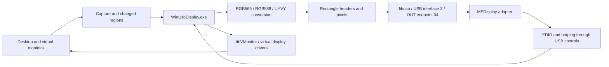

# MSDisplay Windows: static analysis and Android/macOS comparison

Analysis dated 2026-10-19 of the supplied installer
`drivers/MSDisplay_MultiDev_v1.0.0.18.0.exe`, compared with the previous
[Android](android-driver-analysis.md) and [macOS](macos-vs-android-analysis.md)
analyses. Extraction used `innoextract`; PE inspection used Python and LLVM.
Wine was unnecessary. No vendor executable, DLL, driver, or script was run,
and no communication with the USB adapter took place.

The audio follow-up below additionally inspects cached Linux USB descriptors
and ALSA registration state. It does not play sound or issue USB controls.

The [VIDEO_OUT timing inventory](video-out-modes.md) additionally decodes both
applications' 26 timing records and the 45 numeric desktop descriptors in each
of the six IDD DLLs, including a mislabeled 1920x1200 reduced-blanking entry.

## What Windows adds

The video protocol closely resembles macOS: **uncompressed pixel rectangles,
an `FF 00` header, intermediate `FF 80` terminators, and a final `FF C0`
terminator**. Normal initialization selects **MANUAL_BLOCK = 3** when SDRAM
is present and **MEM_BYPAS_BLOCK = 5** when register `0x0030` reports no SDRAM.
This differs from the FRAME = 0 path used by the analyzed APK.

The [partial-update ordering follow-up](partial-update-ordering.md) resolves
an important detail upstream of the USB sender: both Windows versions merge
previous damage into current damage, then retain only current damage for the
next update. It also traces initialization repeats, periodic quadrant refresh,
alignment, batch boundaries, and the full-image mode-5 path.

The [VIDEO_IN limits follow-up](video-in-limits.md) traces persistent setup,
16-bit geometry, four-pixel input-width rounding, SDRAM-dependent memory
formats, bypass checks, and the compiled table's 1600x1200 entry.

The most useful additional findings are:

- **EDID:** an actual read of 256 bytes at `0xC000–0xC0FF`, one byte at a time
  through command `B5`, followed by validation, processing, and delivery to
  the virtual monitor.
- **Hotplug:** polling of `0x0032`, with some paths also monitoring byte
  `0xC07F`, removing or reconnecting the virtual monitor when state changes.
- **Multiple adapters:** enumeration explicitly limits the device list to
  three `534d:6021` adapters.
- **Recovery:** communication error paths issue HID payload
  `B6 DD FF 5A 00 00 00 00`, internally called `set_virtual_plug`.
- **Bypass restrictions:** the mode-5 setup path expects desktop VIC `42`
  (800x600), a scaled target no larger than 800x600, and a target width
  divisible by four. It routes updates through a full-image scaling sender,
  rather than the ordinary sparse-damage sender. These are restrictions of
  this Windows implementation, not established universal silicon limits.

These findings describe the supplied code. They do not establish command
acceptance on our hardware, refresh performance, or the visual effects of
the terminator tokens.

## Reproducible extraction and identification

```sh
bash tools/windows/analyze-installer.sh
```

Dependencies are `innoextract`, `llvm-objdump`, `sha256sum`, Python 3, and the
`pefile` module, all available during this analysis. The script installs
nothing and accesses neither the network nor devices. Artifacts are written
to `drivers/windows-analysis/`, covered by the existing ignore for `drivers/`.

The installer uses Inno Setup 6.0.0 Unicode and contains **two files with the
same destination, `app/WinUsbDisplay.exe`**. The `--collisions rename` option
preserves both; default extraction keeps only the last one. Both are
**PE32 x86**, including the executable whose build path mentions ARM64.

| Extracted file | Size in bytes | Resource version | Linker timestamp, UTC |
| --- | ---: | --- | --- |
| `app/WinUsbDisplay.exe$0` | 1,512,448 | 1.0.0.7 | 2021-05-21 02:59:25 |
| `app/WinUsbDisplay.exe` | 1,635,232 | 1.0.1.6 | 2020-12-10 02:19:26 |

The first imports `libusb0.dll` and `libVMonitor.dll`. The second embeds
libusb-compat/libusb 1.0 code, dynamically loads USB backends, and has neither
of those imports. Its PDB path ends in
`windows-adapter-display-multidev-arm64/Release/WinUsbDisplay.pdb`.
The package also contains an ARM64 INF using the system's `WinUSB.sys`.
These distinguish the variants but do not recover their selection conditions
in the installer's compiled script. Neither the installer filename nor a PDB
path alone establishes an executable's architecture or version.

```text
Installer SHA-256:
7be04791df7cc79fc8427098bf9e3c11206e54d2d613d470e4b4d5855451e816

WinUsbDisplay.exe$0 SHA-256:
85af24188a2040f61f008c50620835b9ddcea0f4c1707447ec11002d55ed134e

WinUsbDisplay.exe SHA-256:
8b72b27c2f493dc433764e977ab939cd491dc6289bc068c52cbcfd9ae547a345
```

Unless stated otherwise, addresses below are preferred virtual addresses in
**`WinUsbDisplay.exe$0`**, whose image base is `0x400000`. The EXE has no
exported function symbols or accompanying PDB. Descriptive function names
here come from calls and embedded log messages; they are analyst labels,
not recovered original C source or symbols.

Main artifacts:

| Path under `drivers/windows-analysis/` | Contents |
| --- | --- |
| `installer-contents.txt`, `extraction.log` | Installer listing and extraction results |
| `unpacked/app/` | Original files, preserving both executable variants |
| `text/app/` | INFs and configuration files converted to UTF-8 for inspection |
| `pe/inventory.json` | Inventory of 32 PE files, including hashes and architectures |
| `pe/app/WinUsbDisplay.exe$0/metadata.json` | Imports, sections, version, and PDB path |
| `pe/app/WinUsbDisplay.exe$0/annotated.asm` | Assembly annotated with import and string references |
| `pe/app/WinUsbDisplay.exe/annotated.asm` | Assembly of the second variant |
| `pe/app/libVMonitor.dll/annotated.asm` | Virtual monitor interface |

`pe-evidence.py` reads binary files without loading them as code;
`annotate-asm.py` annotates LLVM assembly. These annotations do not replace
control flow inspection. The detailed analysis below primarily follows the
first variant. The second also contains the eight-byte control wrapper
(`0x44CCE0`), mode 3/5 selection (`0x44E7C0`), rectangle packer (`0x44E8E0`),
FF80/FFC0 terminators (`0x446E33`), and EDID base C000 (`0x44F317`). This
confirms a shared protocol core without assuming identical display backends.

## How the package works

The adapter-specific protocol lives in the **`WinUsbDisplay.exe` application**.
The conventional USB transport uses libusb-win32. Separate display drivers
provide virtual monitors and image surfaces.



The diagram's interface 3 is a **USB interface number**, unrelated to USB 3.0.

| Component | Evidenced role |
| --- | --- |
| `lib_usb/` | INF for `USB\VID_534D&PID_6021&MI_03`; `libusb0.sys` and x86/amd64 DLLs, version 1.2.2.0 |
| `lib_usb_arm64/` | INF for the same interface using the system WinUSB service |
| `video_driver/dfmirage.*` | Mirror capture driver, declared version 2.0.105.0 |
| `idd/indirectdisplaybus/` | Indirect display device bus |
| `idd/indirectdisplaydriver0`, `1`, `2` | Three UMDF driver sets, declaring the `IddCx0102` extension in their INFs |
| `displayproxy/` | KMD/UMD drivers for `Root\UltrasemiDisplayProxy` |
| `libVMonitor.dll` | Exports monitor creation, connection, and removal; uses `DeviceIoControl` for framebuffer operations |
| `libyuv.dll` | `ARGBToUYVY`, `ARGBToRGB24`, and `ARGBScale` conversion/scaling functions |

Capture code includes GDI (`BitBlt`), DXGI/D3D11, and messages referring to
`DuplicateOutput`/`AcquireNextFrame`. The monitor DLL contains classes for
IDD and WDDM Proxy. Driver detection (`0x40CC70`) selects different paths;
the presence of all these files does not mean they run simultaneously.

The application also contains TightVNC classes, resources, and routines,
alongside JPEG and zlib code, showing reuse of capture/remoting components.
**The inspected USB path sends converted pixels and rectangle headers.**
The presence of codecs and sockets does not establish USB compression or a
network service enabled by default.

Enumeration at `0x442320` compares VID `0x534D` and PID `0x6021`.
Before opening another device, `0x442367` checks whether three are already
present. USB configuration 1 is selected at `0x4440AE`; interface 3 is
claimed at `0x4440F9`; the bulk output endpoint is `0x04` (`0x44D486`).
The Android filter's `345f:9132` ID was not found in this enumeration path.

## USB controls

The wrapper at `0x44D3F0` calls `usb_control_msg` with a fixed eight-byte
length, `wValue = 0x0300`, `wIndex = 0`, and a **600 ms** timeout:

| Operation | bmRequestType | bRequest | Data |
| --- | --- | --- | --- |
| SET_REPORT | `21` | `09` | Eight-byte payload |
| GET_REPORT | `A1` | `01` | Eight-byte response |
| Register read | SET followed by GET | — | `B5 AH AL 00 00 00 00 00`; result at response byte 3 |
| Register write | SET | — | `B6 AH AL VAL 00 00 00 00` |

The read helper is at `0x44D510`, write at `0x44D4A0`, and masked
read/modify/write at `0x44D670`. A critical section protects the SET/GET pair.

| Command | Recovered payload | Evidence |
| --- | --- | --- |
| Manual TRANSMODE | `A6 03 03 00 00 00 00 00` | `0x44D700` |
| Block bypass TRANSMODE | `A6 03 05 00 00 00 00 00` | `0x44D760` |
| VIDEO_IN | `A6 01 WH WL HH HL FMT 00` | `0x44D7C0` |
| VIDEO_OUT | `A6 02 VIC OUT_FMT WH WL HH HL` | `0x44D850` |
| STARTTRANS | `A6 04 ENABLE 00 00 00 00 00` | `0x44EF93` and `0x44E48D` |
| VIDEOON | `A6 05 ENABLE 00 00 00 00 00` | `0x44D8E0` |
| POWERON | `A6 07 ENABLE AUX 00 00 00 00` | `0x44D960` |

POWERON sets `AUX = 02` for `ENABLE = 1` and zero otherwise, as on Android.
The analyzed macOS helper keeps `02` when switching power off as well.

Initialization at `0x44E4CB` reads `0x0030` and selects mode 5 for a result
of 4, or mode 3 otherwise. `0x44EED0` sends the mode, VIDEO_IN, VIDEO_OUT,
and STARTTRANS. The input format combines memory and USB nibbles as on the
other systems. This VIDEO_IN routine fixes its last byte to zero.
For HDMI, it reads `0x0033` to select OUT_FMT, whereas the analyzed macOS
active path passes zero in that field.

Startup also reads `0xC620`, sends POWERON if necessary, and waits for
`0xC454 == 0`, trying up to ten times with 100 ms waits (`0x44E524`).

## Transport-mode selection follow-up

The following traces both EXE variants more deeply, including callers of the
mode-setting helpers and the setup branch used specifically for bypass.
Addresses without a variant suffix refer to `WinUsbDisplay.exe$0`, version
1.0.0.7. The equivalent version-1.0.1.6 paths were also inspected. Selected
assembly excerpts, executable hashes, decoded UTF-16 messages, and field
interpretations are saved under
`drivers/windows-analysis/transport-mode-followup/`; `evidence.json` indexes
the excerpts. Neither executable was run and no USB commands were sent.

### Selection happens during setup, not once per damage rectangle

The function at `0x44E350` is identified by its `usb_plug changeState` log.
For state zero, it disables video, transfer, and power. For a nonzero state,
it first stops transmission, then reads SDRAM type and sets the object's
transfer-mode field:

```c
// Reconstructed pseudocode; addresses and offsets describe this EXE only.
sdram_type = read_xdata(0x0030);       // 0x44E4CB
display->sdram_type = sdram_type;     // object offset 0x30
display->transfer_mode =
    (sdram_type == 4) ? 5 : 3;       // object offset 0x20, 0x44E4F4
build_video_parameters(...);         // 0x44E9E0
if (change_state == 1) {
    ensure_power_on_and_wait();
    configure_mode_input_output();   // 0x44EED0
}
```

The compiled selection uses `3 + 2 * (sdram_type == 4)`. It does not consult
USB speed, current FPS, dirty-region area, or the frame-switch INI thresholds.
Every read result other than 4 selects mode 3; no explicit rejection of
unknown SDRAM values occurs in this selector.

All six located direct callers of `0x44E350` are in the display setup logic
at `0x44617A`, `0x4461BF`, `0x446224`, `0x446293`, `0x4462FB`, and
`0x446331`. They pass state 0 or 1 after checking display availability,
topology, dimensions, and whether a valid VIC exists. Entry to this setup
path is controlled by a virtual-monitor reconfiguration flag at offset
`0x1A` (`0x445AF4`). A small retry/debounce counter delays setup until it
reaches four. Once configured, the flag is cleared and the steady-state
connected path calls the rectangle sender directly (`0x44659C`). That path
does not reselect or reissue the USB transfer mode for every update.

Consequently, hotplug/display reconfiguration can cause the mode to be
programmed again, but normal image changes do not cause adaptive switching
between modes 0, 3, 4, and 5. The located recovery paths request a virtual
plug; they do not contain a fallback that switches from rectangle mode to
whole-frame mode after a transfer failure.

### What the mode dispatcher actually implements

`0x44EED0` reads `display + 0x20` and serializes the command:

| Mode | Dispatcher behavior | Normal selection found |
| --- | --- | --- |
| 0, FRAME | Builds `A6 03 00 00 00 00 00 00` inline at `0x44EF18` | No normal assignment selecting 0 was identified; the SDRAM selector always assigns 3 or 5 before this call |
| 1, FIX_BLOCK_MN | Skips sending TRANSMODE and continues with VIDEO_IN/OUT | None |
| 2, FIX_BLOCK_WH | Skips sending TRANSMODE and continues with VIDEO_IN/OUT | None |
| 3, MANUAL_BLOCK | Calls `0x44D700`, sending `A6 03 03 ...` | Every SDRAM result other than 4 |
| 4, BYPASS_FRAME | Falls through the unhandled-value path without sending TRANSMODE | None |
| 5, BYPASS_MANUAL_BLOCK | Calls `0x44D760`, sending `A6 03 05 ...` | SDRAM result 4, meaning none |

Both mode-3 and mode-5 helpers have one located direct call, from this
dispatcher. After either helper, input color is assembled as
`(memory_format << 4) | usb_format`, input width is rounded up to a multiple
of four, and VIDEO_IN, VIDEO_OUT, and STARTTRANS=1 are sent. The mode-0
serializer is real code, but it does not establish an active Windows
whole-frame sender: the located normal setup chooses block modes, and the
located send paths construct rectangle packets.

In the other EXE, the matching selector is at `0x44DDBB`, its store is at
`0x44DDE4`, and the dispatcher is `0x44E7C0`. It emits mode 3 through
`0x44CFF0` and mode 5 through `0x44D050`. Its mode-0 branch is at
`0x44E808`; modes 1/2/4 have the same omissions. This is shared behavior
across both bundled application variants, not just a single recovered helper.

### Mode 5 has a dedicated, restricted parameter path

In `build_video_parameters`, `0x44EAA8` tests the actual USB mode field for
5 before entering the general port/format logic. Its success path requires:

1. The desktop/timing lookup must return VIC `0x42`, the package's
   800x600 timing. An invalid VIC or a different VIC takes a warning branch.
2. The requested scaled target width must be <=800 and height <=600.
3. The scaled target width must be divisible by four.

The checks do not establish a general positive lower-bound validation for
the target dimensions. The restrictions are accompanied by full Chinese
UTF-16 messages that the ASCII-oriented annotation truncated to `Bypass`:

| Message address | English translation |
| --- | --- |
| `0x4F37F8` | Bypass mode only supports an 800x600 desktop resolution |
| `0x4F3930` | Configure a valid scale resolution for bypass mode |

These are software-policy checks, not an independently established maximum
resolution of every chip's bypass hardware. The warning branches display a
message and return from the parameter builder; they do not switch to mode 3
or propagate a clear mode-validation error to the caller. Setup may continue
with state left by the preceding work, so the warnings should not be
mistaken for a robust capability negotiation.

On the success path (`0x44EAE8` onward), the program stores the scaled target
as the input dimensions, sets VIC `0x42`, sets its refresh field to 60, and
sets both USB and device-memory format fields to zero (RGB565). HDMI output
format is read from `0x0033`; other ports use value 1. It returns two host
flags set to 1: `scale_enable` and `m_membypass`.

The second EXE repeats the same restrictions and field writes at
`0x44E398` onward. Its warnings are at `0x5054D4` and `0x5054A4`,
respectively.

The supplied INI also contains `[mem_by_pass_scale]` with width 400 and
height 200. A corresponding lookup of this section was not found in the
examined EXE configuration code, so those file values must not be presented
as proven applied defaults. The target width/height in the traced branch
come from a mutable parameter record passed by the caller.

### Mode selection, host scaling, and pixel format are different decisions

The display object's relevant fields are:

| Offset | Traced use |
| --- | --- |
| `0x20` | USB transport mode |
| `0x30` | SDRAM type |
| `0x50`, `0x51` | USB and device-memory pixel formats |
| `0x88` | Host scaling enabled |
| `0x8C` | Host flag named `m_membypass` by the log |
| `0x90`, `0x94` | Scaled target width and height |

The returned flags are copied into `0x88/0x8C` at `0x4463D8/0x4463E1`.
`SendRectanglesBywinLibusb` at `0x446DF0` tests the host scaling field,
**not the USB transport-mode field**, when choosing its sender:

* With scaling disabled, it converts and packs the supplied damage
  rectangles, then sends the aggregate directly.
* With scaling enabled (`0x446E30`), it constructs a region for the full
  source display and routes it through `0x446910`. That routine resizes the
  source to the target dimensions, packs a rectangle at `(0,0)` covering the
  complete scaled target (`0x446D2E`), and queues it for the sender thread.

Thus mode 5 retains the FF00/FF80/FFC0 rectangle wire format, but its normal
Windows path sends the entire scaled image whenever an update is processed.
The earlier statement that mode 5 uses the same rectangle packer remains
correct; it must not be read as evidence that Windows uses ordinary sparse
damage rectangles in bypass mode.

Mode 3 can also use this host scaling path: the CVBS, S-Video, and combined
CVBS/S-Video branches read output VIC `0x003C`, derive the target timing,
and return `scale_enable=1`, `m_membypass=0`. Ordinary VGA, HDMI, and digital
branches normally use the direct damage sender. Therefore, a queued/full
scaled update alone does not identify USB mode 5.

There is an unresolved format inconsistency: mode-5 setup programs RGB565,
but the shared scaled sender's libyuv branch explicitly calls ARGBScale and
ARGBToUYVY and packs `2 * target_width * target_height` bytes. It does not
choose a converter using the USB-format field in the way the direct sender
does. No corresponding RGB565 conversion was identified in that scaled
sender. This could reflect
bypass-specific firmware interpretation or incomplete/stale host paths; it
does not justify claiming a clean general RGB565-only or UYVY-only bypass
implementation. Configuration writes and actual conversion calls are
reported separately here.

Both senders use bulk endpoint 04. The scaling worker uses 600 ms timeouts
and a queue with one nominal slot of `0x1D4C08` bytes; it can reject a new
packet when occupied. No buffer-ID field, A6 frame-trigger call, or FRAME
buffer-switch sequence was found in these rectangle send paths.

### The INI's frame switching refers to color format

The original Chinese comments in `config.ini` describe disabling switching,
RGB888-to-RGB565 switching, and a policy based on achieved frame rate. They
do **not** describe selecting adapter frame buffer 0 or 1. Their example
thresholds are 12/20 while the supplied values are 42/18. The section reader
also has the misspelled/empty-section problems described below.

The recovered setup reads `frame_switch_enable` into the main object's
`0x484` field. No runtime consumer selecting USB TRANSMODE from that field
was identified. The ordinary transport selection is still exclusively the
SDRAM equality test above. Neither the word `frame_switch` nor the value 3
in this INI is evidence of page flipping or of an FPS-driven mode-3/5 switch.

### Implications for this repository

Mode 5 is a concrete reference for supporting a no-SDRAM variant, but the
Windows implementation does not support treating it as a drop-in faster
mode for our 1080p UYVY sparse-damage stream. A separate bypass path would
need deliberate mode/dimension selection and an explicit decision about
full-image updates and pixel format. Merely replacing `A6 03 03` with
`A6 03 05` would omit the Windows path's other configuration choices.

The most direct improvements supported by the Windows evidence remain
manual-block batching through FF80/FFC0, retaining SDRAM-aware capability
selection, and keeping transport mode separate from host scaling and pixel
format policy. Nothing in this follow-up establishes mode 5 as faster,
tear-free, or synchronized to physical vblank.

The [mixing/scaling follow-up](transport-mixing-and-scaling.md) compares
these Windows paths with a retained macOS diagnostic that explicitly
alternates modes 3 and 0. That diagnostic does not change the Windows
finding: no normal Windows setup selecting mode 0 or mixing frame and
rectangle transport was identified. It does provide a separate reference
for adapter scaling and deliberate mode transitions.

## Rectangles, pixel formats, and transfers

The packer at `0x44EFF0` builds the same eight-byte header used by macOS
and the Linux module:

```text
FF 00
(x >> 4)
((x & 0xF) << 4) | ((y >> 8) & 0xF)
(y & 0xFF)
(w >> 4)
((w & 0xF) << 4) | ((h >> 8) & 0xF)
(h & 0xFF)
```

It then copies pixels and appends `FF 80 00 00 00 00 00 00`. After packing
all rectangles, the caller changes byte 1 of the last terminator to `C0`
(`0x4474FB`, also `0x446D90`):

```text
[FF 00 position/dimensions][pixels][FF 80 00 00 00 00 00 00]
[FF 00 position/dimensions][pixels][FF 80 00 00 00 00 00 00]
[FF 00 position/dimensions][pixels][FF C0 00 00 00 00 00 00]
```

Windows thus provides a **second occurrence in the supplied desktop drivers**
of FF80 separating rectangles within an update. The inspected path sends
the aggregate buffer in one bulk call. No explicit final zero-length
transfer was found, unlike the Android native path.

The [batch-limit follow-up](mode3-multi-rectangle-batching.md), using Windows
as the primary reference, verifies both send loops have no located fixed
rectangle-count cutoff. Both allocate 6,544,040 bytes for the aggregate; the
bundled `libusb0.dll` splits the application call into at most 64 KiB
submissions, independently of rectangle boundaries. It passes the supplied
600/2000 ms timeout to each chunk's completion wait, so that argument is not
necessarily the complete batch's total deadline.

There are custom RGB565 conversions and libyuv calls for UYVY/RGB24.
When the packer's final argument is enabled, it replaces every pixel byte
`FF` with `FE` before copying (`0x44F09F`); the RGB888 branch passes 1 for
that argument (`0x4474B8`). macOS also changes these bytes in its RGB888
path. Avoiding token collisions is an inferred purpose; the byte
substitution itself is confirmed by the code.

There is no single format for every output. The constructor sets color
policy 3 (`0x4433E8`), distinct from USB TRANSMODE. In VGA/HDMI branches,
with libyuv loaded, this policy selects RGB888 for areas up to 1280×720
pixels and UYVY above that (`0x44EDAC`). Other branches implement RGB565
and SDRAM/resolution-dependent memory formats. A 60 Hz output timing does
not establish 60 new frames per second over USB.

The supplied `config.ini` declares `frame_switch_enable=3`, thresholds
42/18, and `frame_time=3` under the literal section name `[frame_swtich]`.
Its original comments refer to RGB888/RGB565 color-format switching, not
adapter frame-buffer page selection.
The reader is inconsistent: `0x444813` looks for `frame_avg_fre_0` under
`frameframe_swtich_swtich`, while `0x444834` passes an empty section name
for `frame_avg_fre_1`. Those calls default to 42 and 18 respectively.
The INI comments therefore cannot be taken as an accurate specification
of an actively applied dynamic policy.

The direct sender (`0x446DF0`) sends the first update six times with
2000 ms timeouts. Subsequent updates use one call with 600 ms
(`0x447546–0x447638`). It treats positive returns as success without
comparing the returned byte count with the requested length. Another
path uses a queue and worker (`0x446910` → `0x44DF80` → `0x44E230`) in
the scaling branch, also with a 600 ms bulk timeout. Both paths use
the same rectangle tokens. Performance and short transfers were not
tested dynamically.

## EDID and monitor connection

This is the main additional protocol information compared with the paths
located in the APK and Mac binary. In `0x44F820`, VGA/HDMI/digital outputs
enter the read path. Starting at `0x44FA27`, the code does the equivalent of:

```c
// Pseudocode reconstructed from assembly, not original source.
for (unsigned i = 0; i < 256; ++i) {
    set_report({0xB5, 0xC0, i, 0, 0, 0, 0, 0});
    get_report(reply);
    edid[i] = reply[3];
}
```

**EDID uses ordinary register access**, without a new USB request.
This performs 256 SET/GET pairs. A second copy of the loop at `0x44FC90`
handles another virtual display driver type.

Processing called from `0x44F760` validates the header
`00 FF FF FF FF FF FF 00` and the base block checksum in `0x451D40`.
When an extension is present, it also checks the second block and parses
CEA descriptors. It then rebuilds mode data (`0x451A40`). Failed validation
selects embedded EDID blocks such as `0x513328` and `0x5133A8`, according
to SDRAM type. Types other than 1, 2, and 3 directly select the block at
`0x5134A8`. Consequently, the system may receive adapted or replacement
EDID rather than an unchanged copy of the connected monitor's data.

At `0x44FF24`, the result goes to virtual monitor connection/creation.
The DisplayProxy branch explicitly passes 128 bytes to
`libVMonitor!PlugInMonitor` at `0x44133B`. Reading 256 bytes therefore
does not imply every backend presents both blocks in full.

The hotplug worker calls `0x44F310` or `0x44F580` according to chip
identification (`0x002D`, compared with `AD`). In these branches:

- `0x0032 == 1` is treated as a connected monitor.
- Changes trigger virtual monitor connection/removal and notify the
  image sender to reconfigure.
- Some VGA paths also read `0xC07F` and compare it with the previous value;
  this is the base EDID block's checksum byte within the C000 window.
- Depending on the branch, waits include 200 ms during transitions and
  1500 ms in stable states. These are not one universal polling interval.

## Communication recovery over HID

`0x44D9F0` enumerates a HID interface for the same VID/PID and calls
`HidD_SetFeature` with nine bytes:

```text
00 B6 DD FF 5A 00 00 00 00
```

The leading zero occupies the Report ID position in the HID API. The vendor
command is `B6 DD FF 5A 00 00 00 00`, equivalent to writing `5A` to `0xDDFF`.
The internal log message is `open set_virtual_plug`.

The control wrapper invokes this routine after counting ten `-5` returns.
The direct sender also invokes it at each multiple of five counted errors
of types `-116` or `-2`, when recovery is enabled. The queued worker uses
a threshold of twenty for types `-116`, `-2`, or `-5`. Physical reset,
reenumeration, and successful hardware recovery remain unverified.

## Audio follow-up: a separate USB Audio function

The connected `534d:6021` adapter exposes a **USB Audio Class 1.0 playback
function alongside the vendor display interface**. Linux has already bound
that function to `snd-usb-audio` and registered it as ALSA card `extscreen`,
displayed as `usb extscreen`. This is observed device registration, not an
audible HDMI playback test.

Cached sysfs descriptors and current interface bindings show:

| USB interface | Class/subclass | Linux driver | Role |
| --- | --- | --- | --- |
| 0 | `03/00` | `usbhid` | HID controls; interrupt IN endpoint `81` |
| 1 | `01/01` | `snd-usb-audio` | AudioControl |
| 2 | `01/02` | `snd-usb-audio` | AudioStreaming; alternate setting 1 has isochronous OUT endpoint `03` |
| 3 | `FF/00` | `ms912x` | Vendor video; bulk OUT endpoint `04` |

AudioControl's class-specific header declares `bcdADC = 0x0100`. The format
descriptor at cached descriptor offset `0x89` is:

```text
0B 24 02 01 02 02 10 01 80 BB 00
```

It advertises Type I audio with two channels, two bytes per sample, 16-bit
resolution, and one discrete sample rate: `0x00BB80 = 48000 Hz`.
The AudioStreaming general descriptor identifies PCM. Endpoint `03` has
isochronous synchronous attributes (`bmAttributes = 0x0D`). Its high-speed
interval is 1 ms. ALSA's cached stream description independently reports:

```text
USB Display usb extscreen ... : USB Audio
Playback:
  Status: Stop
  Interface 2
    Altset 1
    Format: S16_LE
    Channels: 2
    Endpoint: 0x03 (3 OUT) (SYNC)
    Rates: 48000
    Data packet interval: 1000 us
    Bits: 16
    Channel map: FL FR
```

The PCM substream was `closed` when inspected. The current audio interface
is consequently at idle alternate setting 0 with no endpoints; that does
not mean the streaming alternate setting is missing.

The Windows package's vendor USB INFs target **`MI_03` only**. They do not
replace the separate audio function. Both application variants import only
`timeBeginPeriod` and `timeEndPeriod` from WINMM; no PCM capture/playback API
imports or corresponding audio-engine strings were found. The audio-related
EDID strings refer to parsing Audio/Speaker Allocation data blocks, not to
transmitting PCM samples through the video endpoint.

Windows includes the USB Audio class driver `Usbaudio.sys` for compatible
devices. [Microsoft's driver documentation](https://learn.microsoft.com/en-us/windows-hardware/drivers/audio/usb-audio-class-system-driver--usbaudio-sys-)
describes that support. **Inference:** the Windows setup can provide video
while its separate USB Audio function uses the operating system's class
driver. A proprietary sound stream inside the recovered rectangle protocol
is not needed to explain audio support.

The Android app's permission-checking code mentions `RECORD_AUDIO`, but no
application `AudioRecord`/`AudioTrack` implementation was found in the
decompiled application classes. That permission check alone does not prove
system-audio capture or forwarding.

A closer Android inspection found a `MediaPlayer` helper in
`CaptureService.listenService()` (decompiled Java lines 810–815), which loops
the bundled `res/raw/wusheng.mp3`. It does not capture system audio or write
PCM to a USB endpoint. Decoding that resource to FFmpeg's null output, without
playing it, shows a roughly 25-second, 44.1 kHz stereo file with mean volume
-79.5 dBFS and maximum -64.7 dBFS: nearly silent, not digital zero.
Keeping the OS audio path active is a plausible purpose, not an established
effect. More importantly, `showSystemParameter()`, called during `onCreate`,
sets `triggerAudio = false` at lines 482 and 484, covering both branches.
The connect callback gates `listenService()` on that flag (lines 245–246).
Thus this helper is disabled by normal initialization in this APK.

In the Mac binary, no custom PCM sender or audio device routing implementation
was located. AVFoundation and an `AVCaptureSession` property are present,
but their presence alone does not establish audio handling. The package
payload contains no separate vendor audio driver.

Operating-system support must be distinguished from those vendor programs.
[Android documents host-mode UAC1 support](https://source.android.com/docs/core/audio/usb)
for PCM formats including stereo, 16-bit, 48 kHz; actual routing and adapter
compatibility on a particular phone remain untested.
[Apple documents configuring connected USB audio devices](https://support.apple.com/guide/audio-midi-setup/set-up-audio-devices-ams59f301fda/mac)
through Audio MIDI Setup. Using the adapter's separate class-compliant audio
function on macOS is the expected route, not a playback result obtained here.

For Linux, `ms912x` already matches the vendor interface specifically and
coexists with `snd-usb-audio` on interfaces 1/2. The observed sound device
can be selected as `usb extscreen` / ALSA `extscreen`; adding PCM transport
to the DRM module is not indicated by this evidence. The USB Audio terminal
uses the generic speaker terminal type, which does not itself identify the
physical HDMI connector. Audible HDMI output, any firmware routing/mute
requirements, and the user's desktop audio routing remain untested.

Cached evidence is saved under
`drivers/windows-analysis/audio-observation/`: `usb-descriptors.bin`,
`observation.json`, `stream0.txt`, `pcm0p-info.txt`, and
`pcm0p-sub0-status.txt`. This snapshot applies to the attached `534d:6021`
device, not automatically to every supported MS912x/MS913x USB ID.
The desktop PipeWire connection was unavailable in the analysis sandbox,
so its selected output and profile were not inspected or changed.

## Comparison and implications for Linux

| Aspect | Android | macOS | Inspected Windows code |
| --- | --- | --- | --- |
| Normal transfer mode | FRAME = 0 | MANUAL_BLOCK = 3 | MANUAL_BLOCK = 3; block bypass = 5 without SDRAM |
| Update contents | Whole frame | Changed regions | Rectangles; whole-region updates on initialization/reconfiguration |
| FF00/FF80/FFC0 in the inspected path | No | Yes | Yes |
| EDID read in the located flow | Not found | Not found | 256 bytes using B5 at C000–C0FF |
| Monitor hotplug | Helper, no active polling found | Not established as on Windows | Worker and virtual monitor connection/removal |
| YUV conversion | Custom ARM routine | libyuv | Dynamically loaded libyuv DLL |
| Bulk timeout | JNI 200 ms; Java fallback 1000 ms | 3000 ms | Usually 600 ms; 2000 ms for the initial direct update |
| IDs in filter/enumeration path | 534d:6021; 345f:9132 | 534d:6021 | 534d:6021, explicit three-device limit |

For this repository's module, the strongest findings are EDID reads through
an already known command, another desktop implementation of FF80 framing,
and selection of mode 5 when SDRAM is absent. The deeper transport trace
above adds an important qualification: Windows applies an 800x600 timing
policy and sends full scaled images through its bypass path, with an
unresolved configuration-versus-conversion format discrepancy. Mode 5
should therefore be considered a separate compatibility path. These
findings provide evidence for future changes. This analysis does not modify
the module or establish
that such changes would work on the hardware attached to Linux.

Still unresolved dynamically: exact installer variant selection, display
backend selection on each Windows version, the effect of `0xDDFF`, the full
EDID adaptation policy, and visual synchronization semantics of terminators.
Running the installer under Wine alone would not reproduce the Windows
kernel drivers and graphics backends. All files needed for this static
investigation were already obtained without executing the package.
